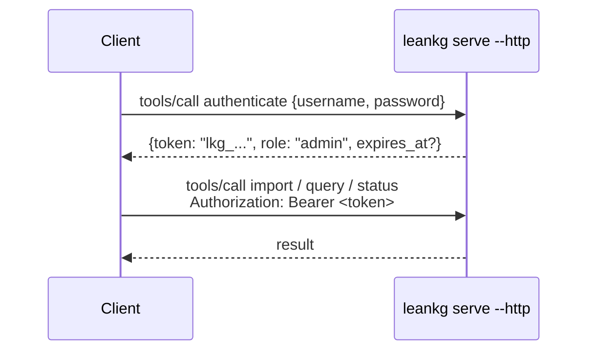

# LeanKG — Agent Context

**Tech stack:** Go 1.25 (module `github.com/FreePeak/LeanKG`) + SQLite (WAL, default) + PostgreSQL/pgvector (opt-in) + official MCP go-sdk. The Rust tree is removed; the repository root is the Go module.

## Build & Test

```bash
make go-build            # CGO_ENABLED=0 binaries into bin/ (leankg, leankg-embed)
make go-test             # go test ./... -count=1  (54 packages)
go test ./internal/store/ -count=1                # one package
go test ./internal/store/ -run TestWatermark -v   # one test; -run is an unanchored regex, so this matches TestWatermarkBumpsOnWrite (internal/store/store_test.go:215)
make go-vet              # go vet ./...
make go-bench            # benchmark/ab suite
make go-build-tstree     # build with the tree-sitter tier (-tags tstree, CGO)
make go-test-tstree      # test that same tier
make dual-engine         # sqlite + live-PostgreSQL acceptance gate (needs :5433 pgvector)
make go-ui-assets        # build ui-v2 and sync dist/ into internal/web/embed
make live-test           # local-only live harness (scripts/live/): exits 1 on the baseline binary by design; not for CI
```

Store contract: `internal/store/roles.go` (one interface per role) and `internal/store/backend.go` (`Backend` composes the roles; SQLite = *Store, PostgreSQL = PGStore). PG tests gate on `LEANKG_TEST_PG_URL` (local fixture: docker pgvector :5433, creds postgres/postgres, db leankg).

Test-layer policy (owner decision, 2026-09-14): **unit tests stay in-process
and fast** — no real provider/network calls, no sleeps; `go test ./...` is
the gate. Anything making a real embedding/LLM/PG call or measuring timing is
an **integration/e2e test** gated on an env var (`LEANKG_TEST_PG_URL`, live
sidecar) or its own job (`ttfv`); **benchmarks (`make go-bench`,
`benchmark/ab`) never run in CI** — they are explicit local/nightly tools.
The `go-engine` CI job runs only the in-process suite (both tag sets) with a
300 s budget.

### Testing conventions

- Unit tests live in `_test.go` files beside the package they cover.
- Fixtures live under `testdata/` (for example `internal/index/testdata/`).
- Use `t.TempDir()` for tests that need filesystem access.
- Tree-sitter tests need the `tstree` build tag (`internal/tstree/tstree_test.go:1`): `go test -tags tstree ./internal/tstree/ -count=1`.

## CLI Quick Reference

|Command|Purpose|
|---|---|
|`leankg serve --http 127.0.0.1:9699 --rest 127.0.0.1:8080 --memory`|MCP HTTP + REST + memory (add `--rpc 127.0.0.1:9090` ConnectRPC, `--ui 127.0.0.1:8081` dashboard, `--read-only` reader role). A non-loopback `--http`/`--rest`/`--rpc` bind is REFUSED unless a token is configured (`leankg auth token create` / `LEANKG_TOKEN_ADMIN`) — see the exposure rule below. `--ui` is the one listener without a refusal (the container demo), but its `/api/file` answers 403 on a non-loopback bind while no token is configured (D1)|
|`leankg index <dir> [--hook] [--no-embed]`|Index a repository (3-signal incremental). A git repo root with commits reads HEAD git objects (uncommitted/untracked/ignored files skipped; change detection by blob ID); a directory without its own `.git` or a repo with no commits keeps the filesystem scan. Then runs the incremental embed unless `--no-embed`; embed failure is reported, not fatal. `--hook` exits 0 without indexing when HEAD has more than `LEANKG_HOOK_MAX_FILES` (default 10000) indexable files (printing the manual `leankg index <dir>` to run instead), or when another index of the store is running; hook embed only attaches to a running local provider and skips (one `embed skipped:` line, exit 0) when more than `LEANKG_HOOK_MAX_EMBED` (default 500) elements need vectors. `--hook` runs under a time budget (`--hook-budget`, else `LEANKG_HOOK_BUDGET`, default 10s): the size gate and the embed stop at the budget, the index stops softly, between directories (a started directory always finishes and is kept); past it the run prints one line and exits 0, and the next run resumes. An extractor-version upgrade resumes from `reextract_cursor`. SIGINT/SIGTERM stop a run at its next unit of work and exit 130.|
|`leankg writer --project <dir>`|Index-once + fsnotify reconcile loop (pairs with `serve --read-only`). For a git-backed store a new commit (change of `.git/logs/HEAD`) triggers a reindex; saving without committing does not change the graph|
|`leankg query <text> [--kind name\|impact] [--depth N]`|CLI query (L1 exact → L2 fuzzy fallback; graph impact)|
|`leankg impact <file> [--depth N]`|Impact radius of a file (same as `query <file> --kind impact`)|
|`leankg-embed run\|full`|Incremental / stamp-guarded full embed (provider via `LEANKG_EMBED_*`). `leankg index` now runs the incremental embed itself|
|`leankg-embed export\|import`|NDJSON offsite flow (pairs with `scripts/hf_embed_job.py`, the Hugging Face Job embedder). `import` stamps the collection exactly as the live provider would for the same `LEANKG_EMBED_*` environment, so a later `run` sees no drift; `--model/--revision/--dims/--distance` are optional and must agree with that environment|
|`scripts/hf-embed.sh [--dry-run] [--yes] [--limit N] [--keep] <project-dir>`|EmbeddingGemma 2 bulk embed on a Hugging Face Job: export, upload to `LEANKG_HF_BUCKET`, `hf jobs uv run` of `scripts/hf_embed_job.py`, download, import. Without `--yes` it prints the estimate and exits 1; a run whose worst case (timeout x hourly price) exceeds `LEANKG_HF_MAX_USD` is refused. Configured by `LEANKG_HF_*`, `LEANKG_EMBED_*` and `HF_TOKEN` (see `.env.example`); never started by the session hook|
|`leankg connect\|install --target claude-code\|cursor\|codex\|gemini\|opencode\|omp`|Client wiring (+ `--register-cwd` async SessionStart hook, matcher `startup\|resume`, running `leankg index --hook "$CLAUDE_PROJECT_DIR"`)|
|`leankg install --target claude-code --register-memory`|Writes three command hooks running `leankg memory hook`: SessionStart (timeout 10, no matcher), PostToolUse (matcher `Write\|Edit`, async) and SessionEnd (timeout 10) into `$CLAUDE_CONFIG_DIR/settings.json` (else `~/.claude/settings.json`), merged and idempotent. claude-code only; see [central agent memory](docs/central-agent-memory.md)|
|`leankg install --target claude-code --register-memory --hook-only`|Same hook merge, and no MCP entry: `~/.claude.json` is not written. Needs `--register-memory`; rejected (exit 2, nothing written) with `--register-cwd`, `--http`, `--url` or `--project`|
|`leankg install --target claude-code --unregister-memory`|Removes only the memory hooks leankg wrote (SessionStart, PostToolUse, SessionEnd); other hooks stay. Rejected (exit 2, nothing written) with any other install flag. Backs up `settings.json` first|
|`leankg memory sync [--dry-run] [--rebuild] [--project SLUG] [--json]`|Makes the central `cc-` banks under `~/.leankg/memory` equal the Claude Code memory files under `~/.claude/projects`. Withholds deletes on an empty or missing scan. Deleted rows are archived to `ccarchive`. `--project` limits the run to one slug; `--rebuild --project` forgets that slug without archiving. Reference: [CLI reference](docs/cli-reference.md#memory)|
|`leankg memory migrate [--project SLUG] [--dry-run] [--json]`|One-time verified import of all Claude Code memory through the sync path; exit 1 when verification fails|
|`leankg memory restore --into DIR [--project SLUG] [--deleted] [--json]`|Rebuilds `<slug>/memory/*.md` and a `MEMORY.md` per project under DIR from the `cc-` banks (and `ccarchive` with `--deleted`). Never overwrites; refuses the Claude Code projects directory|
|`leankg memory recall <query...> [--scope project\|global\|all] [--type KIND] [--limit N] [--dir DIR] [--json]`|Keyword recall over the central banks (same function as the `agent_recall` MCP command)|
|`leankg memory hook`|Hook handler for three events, read from stdin JSON: SessionStart (sync, then print the cross-repository memory block), PostToolUse on Write or Edit of a Claude Code memory file (sync that project only, no stdout), SessionEnd (sync the session's project, no stdout). Empty stdin runs as SessionStart; stdin that is invalid, over 1 MiB or late prints nothing. Always exits 0|
|`leankg doctor --project <dir>`|Store diagnostics|
|`leankg status [--project <dir>]`|Health, inventory, freshness and embed state (JSON)|
|`leankg dashboard [--addr 127.0.0.1:9701] [--no-open]`|Web dashboard (embedded `ui-dashboard`): per-session efficiency metrics, failures, memory, replay; `--format text\|json` keeps the usage tables|
|`leankg telemetry status\|enable\|disable\|purge\|link\|import-ab`|Consent-gated capture (off by default) and transcript linking; see `docs/telemetry.md`|
|`leankg metrics --session [--session-id ID]`|Latest (or named) agent session from the telemetry ledger|

### Embedding text cap (write path)

- `LEANKG_EMBED_TEXT_CAP` (integer, 256-8000 runes) is the operator's write cap. It is used only when the stamp has no recorded cap and the local sidecar's `/props` gives no budget. Any other value is an error. With no stored cap, no `/props` budget and no pin, `run`, `full` and `export` fail before any write and name the pin (exit 1 for the CLI).
- `emb_stamp.text_cap` (migration 17) records the cap the collection was written with. `0` means not recorded: a pre-017 row, or a stamp written by `import`, which never records a cap. The first `run` or `full` fills it in. A recorded cap wins while the identity matches: a `/props` budget below it refuses an incremental run (`leankg-embed full` rebuilds at the new cap), and a larger budget keeps it with a note. `export` cuts at the same cap, so it works while `/props` is down.
- Rollback: an old binary's `full` on a migrated store re-embeds at its own cap but leaves `text_cap` at the value the new binary recorded, so that stamp is stale. Restore the sqlite3 `.backup` taken before the upgrade. Without a backup, `UPDATE emb_stamp SET text_cap = 0;` makes the next run record the cap again; vectors the old binary wrote keep its cut, so follow it with `leankg-embed full`.

## SoT pairing

Narrative + ACs: [`docs/prd.md`](docs/prd.md) (parity ledger + DEFERRED items). Statuses: [`docs/prd-task-tracker.md`](docs/prd-task-tracker.md).

**Current milestone (2026-09-14, PRD v4.11.0): M10 — the self-host dogfood loop.** Once the in-flight
refactor waves land, bring up the dynamic HTTP server (`leankg serve --http 127.0.0.1:9699 --rest 127.0.0.1:8080 --ui 127.0.0.1:8081 --memory`)
over this repository — index + embed + memorize — and use it to build/fix LeanKG itself (PRD §3.10 + §5.1 runbook)
before scaling to small nested-repo parents. Never bulk-index the `freepeak` portfolio root.

## Development workflow

1. Update `docs/prd.md` + `docs/prd-task-tracker.md` (the only two live docs)
2. Implement in `internal/` + `cmd/` — store consumers depend on the narrowest role they use (plan section 3.3); only composition roots (`cmd/*`, `core.New`, `store.OpenBackend`) hold a `store.Backend`; no concrete store type outside `internal/store`
3. `make go-build && make go-test && make go-vet`
4. Commit (one feature per commit; no AI attribution); main is protected → PRs only
5. `scripts/test-dual-engine.sh` for storage-layer changes

## Context and cancellation conventions

- `ctx` is the first parameter and is never stored in a struct. Exception: a background-runner type that owns a server-lifetime ctx and is joined at shutdown.
- `context.Background()` appears only in `package main` and tests. Detached cleanup (rollback, flush on close) uses `context.WithoutCancel(ctx)`, with `context.WithTimeout` on top when the tail must be bounded.
- `context.TODO()` is only a tracked migration marker and must not survive a merged P3 or P4 PR.
- Use `exec.CommandContext`, `http.NewRequestWithContext`, and set `Timeout` on every `http.Client`.
- Long loops check `ctx.Err()` once per unit of work and return it; cancellation is never counted as a data failure.
- Servers: validate first, return the first listener error, await `Shutdown`, then close the stores.
- Enforced by `internal/archtest` (ratchet budgets): a budget that goes down must be lowered in the same diff.
- Plan: `docs/plan-context-and-interfaces-refactor.md` (sections 4 and 5).

## Release

One workflow: `.github/workflows/release.yml`. A merge to `main` makes
release-please open/update the release PR; merging *that* cuts `vX.Y.Z`, publishes
the GitHub Release and builds the four `leankg-<goos>-<goarch>.tgz` assets **in the
same run** — deliberately, because a tag pushed with `GITHUB_TOKEN` cannot trigger a
follow-up workflow (that is how v0.28.1–v0.30.0 shipped with no binaries).

- Version source of truth: `cmd/leankg/VERSION`, declared as release-please's
  `version-file`; `internal/mcp/server.go` keeps the `x-release-please-version`
  marker for its copy, and `internal/mcp/version_test.go` fails on drift.
- `.release-please-manifest.json` is keyed by package **path** (`"."`). A key of
  `main` is never read, and any non-version value (e.g. a `$schema` key) makes
  release-please throw while loading the manifest.
- The simple release strategy's releasable commit types exclude `chore`/`refactor`/`docs`:
  a merged `refactor!`/`BREAKING CHANGE` squash opens **no** release PR ("No user facing
  commits found" in the version job). When the cut must ride such a commit — e.g. the
  #403 module-root move, shipped as v0.33.0 — declare the version deliberately with an
  empty `Release-As: X.Y.Z` trailer commit; it forces the release PR on the next push.
- `leankg update` polls `releases/latest`, so the release must be non-draft and
  marked latest; asset names and the archive layout are a contract with
  `internal/update`. `--latest` is claimed only when the version is at least
  the current latest, so re-publishing an older release cannot downgrade clients.
- `scripts/release_workflow_guards.py` (a CI step) pins three invariants of that
  workflow: no job may gate on `inputs.*` (empty in a job-level `if` on
  dispatch), publish must assert the asset count, and `--latest` must stay
  conditional. Each maps to a defect that shipped a green run with zero
  binaries — edit `release.yml` and CI will tell you which one you re-introduced.

## Key source files

|File|Purpose|
|---|---|
|`cmd/leankg/`|serve/index/writer/query/doctor/connect/install|
|`cmd/leankg-embed/`|embedding pipeline binary|
|`internal/store/`|Backend interface, SQLite + PostgreSQL implementations|
|`internal/core/`|3-tool envelope + L0–L3 ladder|
|`internal/index/`, `docindex/`, `prdindex/`|code / markdown-doc / PRD-requirement extractors (regex tier; tree-sitter behind `-tags tstree`)|
|`internal/memory/`|full-markdown memory + mnemopi banks|
|`internal/ccmemory/`|central agent memory: Claude Code memory files to `cc-` banks (sync, migrate, recall, hook)|
|`internal/mdmeta/`|leaf helpers: frontmatter splitter and `[[link]]` extractor (used by `ccmemory` and the Obsidian sync)|
|`internal/embed/`|Provider port, ModelStamp guards, pipeline, pinned model catalog (`catalog.go`)|
|`scripts/hf-embed.sh`, `scripts/hf_embed_job.py`|EmbeddingGemma 2 bulk path on a Hugging Face Job (orchestrator and in-job embedder)|
|`internal/graph/`|impact/path/callers/callees/context/explain|
|`internal/mcp/`, `rest/`, `rpc/`, `web/`|transports + UI|
|`internal/telemetry/`|per-user capture ledger (`$LEANKG_HOME/telemetry.db`), consent config, redaction, classifier; `metrics/` builds the dashboard reports, `report/` is the API contract|
|`internal/sessionlink/`|read-only, consent-gated linking of calls to agent transcripts (one adapter per client)|
|`internal/dashboard/`, `ui-dashboard/`|`leankg dashboard` server + SPA (`make go-ui-dashboard` builds and embeds it)|
|`internal/tstree/`|vendored generated grammars (objc/dart/perl) — build-tag gated|
|`internal/langs/`|language registry: which languages are indexed, and lazy activation per codebase|
|`benchmark/ab/`|A/B benchmark harness (seeded `testing.B` suites, run with `make go-bench`)|
|`internal/archtest/`|ratchet tests: store roles take ctx, context.Background/TODO and ctx-less I/O budgets (plan: docs/plan-context-and-interfaces-refactor.md)|
|`ui-v2/`|graph explorer SPA (Vite + React); `make go-ui-assets` builds it into `internal/web/embed`|

## Multi-project setup

MCP HTTP `?project=` walks to the nearest `.leankg`; `LEANKG_DB_ENGINE=postgres` + `LEANKG_PG_URL` switch storage. Never paste personal host paths into commits.

## Self-ontology (`ontology/`)

The repository ships its own ontology: `ontology/concepts.yaml` and `ontology/workflows.yaml` describe the MCP surface, search ladder, storage backends, auth gate and the main workflows. Every `code_refs`, `entry_points` and `docs` path in them is repo-relative, and `internal/ontology/repo_ontology_test.go` loads the files through the real loaders and fails when a named path no longer exists, so update the YAML in the same change that moves a file.

Load it into a project store after indexing it (MCP):

```
import  {action: "ontology", path: "ontology"}
query   {action: "ontology", args: {cmd: "status"}}
query   {action: "ontology", query: "search ladder", args: {cmd: "concept_search"}}
```

The import is explicit. Nothing syncs the ontology on boot or on file change.

## Auth and the HTTP gate

The MCP surface is four tools: `import`, `query`, `status`, and `authenticate` (the login tool).

`authenticate` takes `{ "username": "<username>", "password": "<password>" }`. On success it returns `{ "token": "lkg_...", "role": "admin", "expires_at": "<RFC3339>" }`; `expires_at` is omitted when the token does not expire. The token is a revocable bearer token from the existing token system. Clients send it as `Authorization: Bearer <token>` on later requests. A failure is one generic `invalid credentials` error that never says whether the user exists. After 5 consecutive failures for a username, `authenticate` returns a rate-limit message and locks that username out for 60 seconds.



**Gate.** The gate is on when any of these holds: an env token (`LEANKG_TOKEN_ADMIN`, `LEANKG_TOKEN_CONTRIBUTOR`, `LEANKG_TOKEN_VIEWER`) is set, a database token exists (`leankg auth token create`), or a site-admin account exists. The HTTP layer only resolves the caller; the anonymous restriction is enforced in one MCP middleware. With the gate on:

- a request with no `Authorization` header can reach only the protocol handshake (`initialize`, `ping`, `notifications/initialized`, and the 2026-07-28 `discover`), `tools/list`, and `tools/call` for `authenticate`; `import`, `query` and `status` need a valid token;
- a request carrying an invalid or expired token gets HTTP 401.

The same gate covers REST and ConnectRPC. Those surfaces have no login tool, so once a site admin exists they need a bearer token minted with `leankg auth token create`.

**Route roles.** Every route on a gated listener declares its role at registration: `auth.Require(auth.Contributor, h)` for a write, `auth.Require(auth.Viewer, h)` for a read, and `auth.Public(h)` for a route with no role floor (the auth bootstrap, liveness, the MCP handshake). The gate stores the caller's role in the request context; `Require` reads it and denies a request that has no role. `internal/archtest` fails on a route registered without a declaration.

stdio (`leankg serve --stdio`) is not gated. It runs as Admin because it is a local subprocess started by the user.

**Account status.** A token minted for an existing account stops authenticating (the same 401 an unknown token gets) while that account is not `active`, so disabling an account revokes its tokens at once. A token whose account id has no row (a free-form label from before accounts existed) is not affected and keeps its minted role; a token with no account id is unchanged.

**Project grants.** A token can be limited to some registered projects with `project:<name>` scopes, where `<name>` is the project's directory basename (the name `?project=` and the `project` argument resolve by). Mint it with the existing scope flag:

```bash
leankg auth token create --name ci-alpha --role viewer --scopes project:alpha
```

- A token with at least one `project:` scope reaches only the named projects. A project it does not cover is refused with `LEANKG_ERROR_PERMISSION_DENIED` (REST: 403). An unknown name gets the same refusal, so the response never reveals which projects exist.
- A token with no `project:` scope is unrestricted for projects, and so is a token whose scopes are all other names. stdio and the local open gate carry no token, so they are unrestricted too.
- A `project:<name>` grant matches the basename only when exactly one registered project has that basename; when two share it, a restricted token is refused both with the same refusal as a withheld project, and an unrestricted caller reaches both.
- Routed project choices share one check: `projects.Router.Authorize`, which `Open` uses. It covers the MCP `?project=` and `project` argument, the REST `?project=` and default project, auto-config `?project=` and default project, and the dashboard `/api/` and ConnectRPC surfaces, which serve the default project. The one exception is an MCP server with no router, whose default engine is checked directly against the grant by basename. An MCP call that omits `project` is refused with `LEANKG_ERROR_MISSING_PARAM` when several projects are registered; it serves the default engine only when one project is registered, and the grant applies to that engine. The dashboard project switch (`POST /api/project/switch`) also goes through `Authorize`: a withheld project is 403 with no path or name of that project. The portfolio fan-out and its T0 summary skip withheld projects and report `projects_withheld` (a count, 0 when none); a restricted caller's portfolio answer has no `registry` field.
- Every routed surface enforces the grant. With the gate on, the dashboard `/api/` data routes and ConnectRPC resolve the caller like REST: no or unknown token is 401 (`LEANKG_ERROR_UNAUTHORIZED`); a restricted token that does not cover the default project is 403 (`LEANKG_ERROR_PERMISSION_DENIED`); a covering or unscoped token is 200. With the gate off (no token configured) both stay open, as before. The dashboard's static UI assets (the shell, JS, CSS, favicon) stay public with the gate on; only `/api/` is gated, so a browser can still load the page. A token scoped to a project other than the default gets no RPC access (fail-closed, 403), while `/health` on that listener still answers 200 to any valid token, and the dashboard shell loads but `/api/` returns 401 to the bundled UI, which sends no Authorization header when the gate is on.
- Token and account endpoints follow the grant too. `POST /api/v1/auth/token` gives a restricted caller's new token that caller's `project:` scopes, and a body cannot add scopes; an unrestricted caller mints as before. `GET /api/v1/auth/token` and `POST /api/v1/auth/token/revoke` reach only the restricted caller's own token, and the org and resource-claim endpoints (`/api/v1/auth/org*`, `/api/v1/auth/resource/claim`) refuse a restricted token. An anonymous HTTP caller (no Authorization header while the gate is on) is denied every project.
- A restricted token that does not cover the default project gets 403 from REST `/health` (RPC `/health` still answers 200 to any valid token).

**Admin bootstrap.**

```bash
leankg auth admin init [--username <username>] [--env-file <path>]
```

- Defaults: username `admin`, env file `.env` in the project root.
- Creates one site-admin account in the project's store (SQLite default, PostgreSQL parity). The database keeps only the PBKDF2 password hash.
- Appends `LEANKG_ADMIN_USERNAME` and `LEANKG_ADMIN_PASSWORD` to the env file, preserving existing lines, and sets the file mode to 0600. `.env` is git-ignored.
- Idempotent. If the account already exists but the env file has no matching password, it fails without changing anything.
- The server does not read `.env`. The file is the user's copy of the credentials for clients.

## The self-host: ONE server, and how to restart it without being fooled

`leankg serve` is supervised by launchd (`com.freepeak.leankg-serve`, program
`~/.local/bin/leankg-serve-wrapper`, which scans `$LEANKG_SCAN_ROOT` and passes
`--http 127.0.0.1:9699 --rest 127.0.0.1:9700 --memory --embed-provider local
--hindsight-compat`). Restart it with:

```bash
launchctl kickstart -k gui/$(id -u)/com.freepeak.leankg-serve
```

**A non-loopback bind is REFUSED, not warned about.** `leankg serve
--http/--rest/--rpc <non-loopback>` exits with an error unless a bearer token
is configured (env `LEANKG_TOKEN_ADMIN`/`_CONTRIBUTOR`/`_VIEWER`, a token
minted by `leankg auth token create`, or a site-admin account from
`leankg auth admin init`, which counts as configured). With the gate off every caller resolves
to Admin, so the old behaviour (warn, then bind anyway) put the project graph,
the file reader and the memory write path on the LAN — measured 2026-10-21, a
LAN POST to the REST listener answered `{"written":1}`. The refusal names both
ways out: bind `127.0.0.1`, or configure a token first. `--ui` is the ONE
deliberately public listener (the container demo serves `--read-only --ui
:${PORT}` to the internet), so it keeps a loud warning instead of a refusal. Its
`/api/file` reader is the exception (D1): with the gate on it needs a Viewer
token, and with the gate off it answers 403 `PERMISSION_DENIED` on any
non-loopback bind, so the demo needs a token for the file viewer.
Rule + test: `internal/servebind`, `cmd/leankg/servebind_test.go`.

**A restart can leave a duplicate behind, and the duplicate can be the one
answering you.** Measured 2026-10-12: a manually started server (`--http :9699`,
wildcard) was still alive 2h41m later on the SAME ports as launchd's
(`--http 127.0.0.1:9699`). Both bound successfully — different address families
— and `curl 127.0.0.1:9699` reached whichever held the IPv4 socket. So a
"restart then verify" loop can read a server you never restarted, and every
conclusion drawn from it is about the wrong binary.

Two habits that avoid it:

```bash
# 1. Find the LISTENERS, not the processes you meant to kill. A pkill pattern
#    copied from the wrapper misses any server started with a different argv.
lsof -nP -iTCP:9699 -sTCP:LISTEN    # one line is not the same as one server
lsof -nP -iTCP:9700 -sTCP:LISTEN    # and the same pid here

# 2. Kill by the LISTENER's pid, then confirm the port is free before starting.
kill -TERM <pid>; sleep 3; lsof -nP -iTCP:9699 -sTCP:LISTEN   # empty
```

**One pid is not the same as one line.** Measured 2026-10-12 (the case above)
and again 2026-10-13: the duplicate ran `--http :9699` (wildcard → an **IPv6**
socket) while launchd's runs `--http 127.0.0.1:9699` (an **IPv4** socket), so
`lsof` prints TWO lines, one per address family, and both belong to servers that
are both answering. Reading that as "one server per line" hides the duplicate;
read it as "these are the sockets, they must all be the same pid".

Keep the pid launchd claims, and kill the other:

```bash
lsof -nP -iTCP:9699 -sTCP:LISTEN          # two lines, two pids
launchctl print gui/$(id -u)/com.freepeak.leankg-serve | grep pid   # the one to KEEP
kill -TERM <the other pid>
```

The duplicate is also the one on **`localhost`**: a client that resolves
`localhost` may reach `::1` and land on the wildcard server instead of the
supervised one. And it holds no REST port — launchd's server won `:9700` — so
`:9699` and `:9700` belong to *different* pids, which is the same broken state as
the `000` case above, just harder to notice because nothing fails.

After a restart, both ports must be owned by the SAME pid, and that pid must be
the one `launchctl print` reports.

*Last updated: 2026-10-13 (self-host runbook: two lsof lines are two SOCKETS, not two servers — read the pid, and keep launchd's)*
