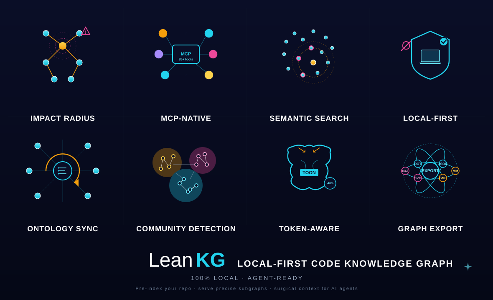

<p align="center">
  
</p>

<h1 align="center">LeanKG</h1>

<p align="center">
  <strong>Enterprise-ready code knowledge graph for AI coding agents</strong><br>
  Multi-repo · env governance · incidents &amp; services · req↔code · −65% tokens / −85% tool calls
</p>

<p align="center">
  <a href="https://leankg.onrender.com"><strong>Live Demo</strong></a>
  ·
  <a href="docs/prd.md">Docs</a>
  ·
  <a href="https://pkg.go.dev/github.com/FreePeak/LeanKG">pkg.go.dev</a>
  ·
  <a href="CHANGELOG.md">Changelog</a>
</p>

<p align="center">
  <a href="https://github.com/FreePeak/LeanKG/releases/latest"></a>
  <a href="https://pkg.go.dev/github.com/FreePeak/LeanKG"></a>
  <a href="https://github.com/FreePeak/LeanKG/blob/main/LICENSE"></a>
</p>

<p align="center">
  
  
  
  
</p>

<p align="center">
  
</p>

---

## What is LeanKG?

LeanKG is a code knowledge graph for AI coding agents, shipped as a single CGO-free Go binary
(`github.com/FreePeak/LeanKG`, root module — see [pkg.go.dev](https://pkg.go.dev/github.com/FreePeak/LeanKG)).
Where agents usually rebuild structure with grep → open files → huge context, LeanKG returns a
targeted subgraph (callers, dependents, blast radius, tests, docs) plus a team layer (env,
services, incidents, requirements) over MCP. The Rust engine was removed at the parity cutover;
build with `make go-build`, test with `make go-test`. See [docs/prd.md](docs/prd.md) for the
parity ledger.

| Without | With LeanKG |
| ------- | ----------- |
| Many tool calls, large context | Surgical subgraph + TOON (~40% smaller payloads) |
| No blast radius | Severity-graded impact |
| Keyword only | Keyword + HNSW semantic + ontology |
| Single-repo guesswork | Multi-repo index + ops tools |

## Get Started

```bash
# 1. Per project: one-shot index, then an incremental embed (sqlite default — zero config,
#    store at .leankg/leankg.db). In a git repo root it reads the HEAD commit's objects, so
#    uncommitted, untracked and ignored files are not indexed. Add --no-embed to skip the embed.
cd your-project
leankg index .

# 2. Wire up an AI client — one command (claude-code | cursor | codex | gemini | opencode | omp).
#    The stdio entry is `serve --stdio --memory`: the agent gets the code graph AND the
#    markdown memory layer (per-project at <project>/.leankg/memory), no second server.
leankg install --target claude-code  # `connect claude-code` is the same writer
#    Restart the client afterwards so it picks the entry up.

# 3. ...or serve MCP over HTTP yourself (endpoint /mcp; GET /health returns 200 when ready)
leankg serve --http 127.0.0.1:9699 --rest 127.0.0.1:8080 --memory
leankg install --target claude-code --http --url http://127.0.0.1:9699/mcp
```

Semantic (L3) search is the one optional layer: it needs embeddings. Set
`LEANKG_EMBED_PROVIDER` (see [docs/embedding.md](docs/embedding.md) and
[`.env.example`](.env.example)); `leankg index` then embeds incrementally after
indexing. Until an embed runs, queries answer from exact + fuzzy matches.

Self-check any deployment: `leankg doctor` — prints the store path, element and
file counts and the write watermark (exit 0 pass / 2 fail).

MCP over HTTP: the server resolves the project from its process cwd — run it
from the checkout or pass `--project DIR` to pin one.

## Installation

None — **sqlite is the default storage engine**. No Postgres, no Docker.

Postgres remains available as an explicit opt-in (`LEANKG_DB_ENGINE=postgres` + `LEANKG_PG_URL`) for server-scale deployments, but nothing in the default flow touches it.

**Published module** — the engine is a Go module, so the toolchain installs both
binaries from [pkg.go.dev](https://pkg.go.dev/github.com/FreePeak/LeanKG) straight into `$(go env GOPATH)/bin`:

```bash
go install github.com/FreePeak/LeanKG/cmd/leankg@latest         # server + CLI
go install github.com/FreePeak/LeanKG/cmd/leankg-embed@latest   # embedding pipeline
```

**Prebuilt archives** — [releases](https://github.com/FreePeak/LeanKG/releases/latest)
carry `leankg-<os>-<arch>.tgz` for linux/darwin × amd64/arm64, both binaries at the
archive root plus a `.sha256`. `leankg update` follows the same channel.

**From a checkout** — requires [Go 1.25+](https://go.dev/dl/) and git; installs to
`~/.local/bin` (pass a `PREFIX` to change it):

```bash
git clone https://github.com/FreePeak/LeanKG.git && cd LeanKG
scripts/install-go.sh                # or: make install-go

# Or fetch and run the installer directly (clones over HTTPS, same behavior):
curl -fsSL https://raw.githubusercontent.com/FreePeak/LeanKG/main/scripts/install-go.sh | bash
```

**Container** — [Dockerfile](Dockerfile) is a three-stage CGO-free build: engine binaries, then a
demo graph baked from a slice of this repo, then an unprivileged runtime that serves that store
read-only.

```bash
docker build -t leankg .
docker run --rm -p 8080:10000 -e PORT=10000 leankg   # dashboard + its /api on :8080
```

## MCP surface

Discover with `query` — it routes down the ladder by default (L1 exact → L2 keyword → L3 semantic; a natural-language question goes straight from an L1 miss to L3, which fuses keyword and vector ranks), degrades instead of erroring, and every answer carries `retrieval{rung,reason}` + `freshness`.

| Question | How |
| -------- | --- |
| Any identifier (default) | `query "Alpha"` (exact, then fuzzy fallback) |
| Session start memory | `query` action=memory args.command=session_recall |
| Session end retain | `import` action=memory command=session_retain |
| Blast radius | `leankg impact <file>` or `query --action impact --to <qn>` |
| Who calls X? | `query --action callers --to <qn>` |
| How A↔B? | `query --action path --to <qn>` |
| Element details | `query --action explain --to <qn>` |
| Pattern search | `query --action pattern --pattern "func $_(...)"` |
| PRD traceability | `leankg prd-trace FR-3T-01` |
| File (compressed) | `query --action read --path src/main.go` |

3 tools: `import` (index/PRD/memory/session/ontology/read) · `query` (ladder + graph verbs + actions) · `status` (inventory/freshness/config).

## Features

- **MCP-native** — search, impact, call graphs, ontology, architecture, team knowledge
- **SQLite default** (zero-config — no Postgres, no Docker required) with an opt-in Postgres/pgvector backend (`LEANKG_DB_ENGINE=postgres` + `LEANKG_PG_URL`)
- **Ontology** — concept catalog + procedural layer (workflows, steps, decision points, failure modes), `query --action ontology`, `POST /api/v1/ontology/match`, and req↔code traceability via `leankg prd` / `prd-trace`
- **Impact & deps** — `contains`, `calls`, `imports` edges; BFS blast radius (`leankg impact`)
- **Multi-repo server** — MCP HTTP `:9699`; `LEANKG_PROJECT_DIRS` serves many projects, selected per request by `?project=<dir|name>` (REST **and** MCP) or the MCP `project` tool argument; with neither, a multi-project server refuses rather than answering from the wrong graph. sqlite default, PG opt-in
- **Env governance** — `query --action env_conflicts`, per-env snapshots, `leankg obsidian`
- **Ops & ownership** — `query --action service_context` / `incidents`, `leankg incident` / `note` / `team-map`
- **Req ↔ code** — `leankg prd` / `prd-trace`, `query --action prd`, ontology traceability matrix
- **Web UI v2** — Force / Tree / Circles explorer (`cd ui-v2 && npm run dev`; the embedded build is served by `leankg serve --ui`)
- **Deploy** — single CGO-free binary, no runtime deps: [Dockerfile](Dockerfile) builds a read-only demo image for Render, `/health` answers container probes, and `--ui` / `--http` / `--rest` / `--rpc` each bind their own address
- **Languages** — 40 profiles: Go, Rust, TypeScript/TSX, JavaScript/JSX, Python, Markdown, Java, Kotlin, Swift, Objective-C, Dart, C/C++, C#, PHP, Ruby, Scala, Perl, Lua, Haskell, Elixir, Crystal, CUDA, Cypher, Elm, Erlang, F#, GLSL, HLSL, Nim, OCaml, SQL, PowerShell, Q#, Solidity, SystemVerilog, Verilog, Zig
- **Agent economics** — A/B −65% tokens, −85% tool calls, 2.5× vs grep/cat; peers in this space are mostly personal / single-repo. Deep dives (archived): [competitive analysis](docs/archive/competitive-analysis.md) · [ROI vs Graphify](docs/archive/reports/leankg-vs-graphify-company-roi-2026-07-21.md) · [research matrix](docs/archive/analysis/leankg-competitive-research-and-improvement-strategy-2026-08-02.md)

## Embeddings

Semantic (L3) search needs embeddings; see [docs/embedding.md](docs/embedding.md) for providers (`local` / `openai` / `deterministic`), the EmbeddingGemma 2 + Hugging Face Storage Bucket bulk path, and the `.env.example` variable list. The catalog rows (model id, pinned revision, dimensions, prefixes) live in `internal/embed/catalog.go`.

## Performance

- **Go cold time-to-first-value** — 17.8s (macOS arm64); CI budget 300s, gate "Cold TTFV" in `.github/workflows/ci.yml`, per-run numbers in the `ttfv-go-cold` artifact.
- **Quickstart happy path** — 1.4s warm on a generated 10-file Go fixture (index 0.05s, server bind 1.08s, first query 0.05s, doctor 0.03s); `scripts/quickstart_smoke.sh` runs the same steps locally (`QUICKSTART_DRY_RUN=1` prints the plan).

## CLI

```bash
leankg index .                          # one-shot index + incremental embed -> .leankg/leankg.db (--no-embed skips the embed)
leankg index --hook <dir>               # SessionStart mode: skips over LEANKG_HOOK_MAX_FILES (10000) files or LEANKG_HOOK_MAX_EMBED (500) elements needing vectors
leankg writer                           # index once, then watch; a git-backed store re-indexes on each new commit (unsaved edits do not change the graph)
leankg query "parseConfig"              # name lookup (exact, then fuzzy) — JSON out
leankg query "parseConfig" --compress   # one line per result
leankg impact src/main.go --depth 3     # blast radius of a file or element
leankg status                           # health, inventory, freshness, embed state
leankg doctor                           # store path, element/file counts, watermark
leankg connect claude-code              # MCP entry: claude-code|cursor|codex|gemini|opencode|omp
leankg install --target cursor          # same wiring, flag form (--register-cwd: async claude-code SessionStart hook running `index --hook`)
leankg serve --stdio                    # MCP over stdio (what harnesses spawn)
leankg serve --http 127.0.0.1:9699      # MCP over streamable HTTP (/mcp, /health)
leankg serve --rest 127.0.0.1:8080      # REST API (/health, /api/v1/*)
leankg serve --ui 127.0.0.1:8081        # embedded dashboard (/api/* data API served here)
leankg serve --rpc 127.0.0.1:9090       # ConnectRPC (gRPC + gRPC-Web + JSON)
leankg version
```

UI hot-reload: `cd ui-v2 && npm install && npm run dev` → http://127.0.0.1:5173

Full usage: `leankg help` and `leankg <command> --help`. Archived CLI reference: [docs/archive/cli-reference.md](docs/archive/cli-reference.md)

## Known limits

- **Call edges are package-scoped.** No import/type resolution, so a same-name call in the same package resolves and cross-package dispatch is best-effort; the upgrade path is tree-sitter symbol tables.
- Heuristic guards in `internal/index/relations.go`: files ≥ 1 MiB are skipped as vendored/minified bundles, call targets shorter than 4 characters are dropped as noise, and outgoing calls are capped per element and per file.
- The **unit of scope is a repository.** A portfolio root (tens of thousands of nested files) is not a project; register its children one at a time.
- `--ui` binds an **unauthenticated** data API (`query`/`read`/import routes). Bind it loopback or front it with a proxy — the public demo container serves it `--read-only` against a disposable baked graph.

## Troubleshooting

| Issue | Fix |
| ----- | --- |
| Wrong project served | Start the server with `--project DIR` (`query`/`impact` also honor `LEANKG_PROJECT`) |
| Embeddings / cold embed | `leankg-embed status`, then `leankg-embed full` (provider env: `LEANKG_EMBED_*`) |

**Requirements:** macOS or Linux · Go 1.25+ only when building from source. No
Docker, no Postgres — sqlite is the default store.

## Documentation

The documentation set lives in [`docs/`](docs/) — a single unified PRD (`docs/prd.md`) + task tracker (`docs/prd-task-tracker.md`). All historical design docs, analyses, reports, and plans are preserved under [`docs/archive/`](docs/archive/).

| Doc | |
| --- | --- |
| [PRD](docs/prd.md) | Unified product requirements + HLD (single SoT) |
| [Task tracker](docs/prd-task-tracker.md) | Done / in-progress / todo |
| [Architecture (archived)](docs/archive/architecture.md) | Design & data model (historical) |
| [MCP tools (archived)](docs/archive/mcp-tools.md) | Tool catalog (historical) |
| [CLI (archived)](docs/archive/cli-reference.md) | All commands (historical) |
| [Benchmarks (archived)](docs/archive/benchmark.md) | Methodology (historical) |
| [Embeddings](docs/embedding.md) | Providers + EmbeddingGemma 2 / Hugging Face bulk path |
| [AGENTS.md](AGENTS.md) | Agent notes |

## Contributing

1. Fork + feature branch (prefer a worktree)
2. Update docs when behavior changes
3. `go build ./... && go vet ./... && go test ./...`
4. Open a PR with summary + test plan

## License

[Apache License 2.0](LICENSE)