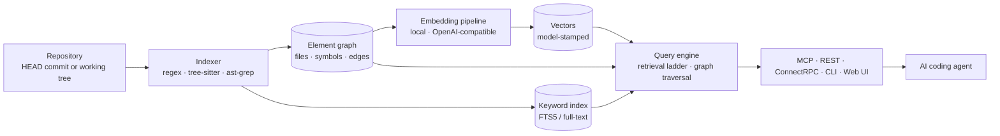
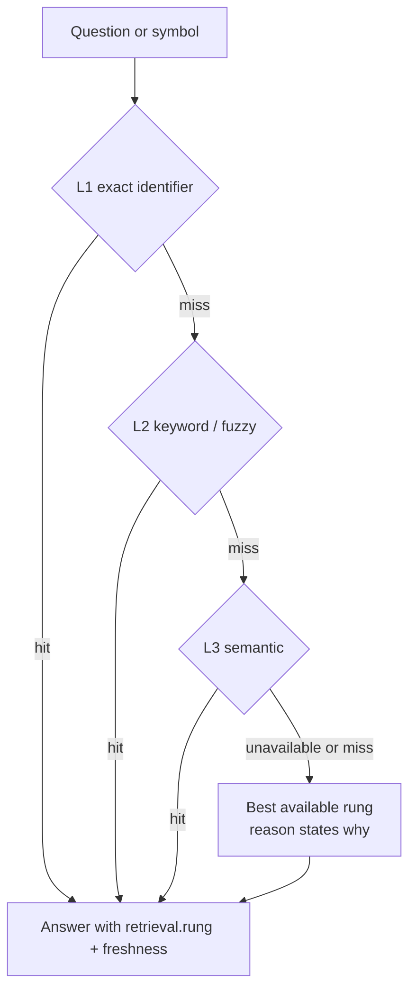
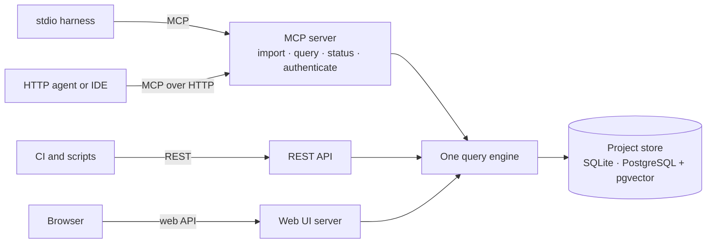

<p align="center">
  
</p>

<h1 align="center">LeanKG</h1>

<p align="center">
  <strong>A self-hosted code knowledge graph and access-controlled context layer for AI coding agents</strong>
</p>

<p align="center">
  Agents stop grepping blind. They ask a structured question, get a traceable
  answer from the real repository, under your access rules.
</p>

<p align="center">
  <a href="docs/getting-started.md"><strong>Get started</strong></a>
  &nbsp;&middot;&nbsp;
  <a href="docs/architecture.md"><strong>Architecture</strong></a>
  &nbsp;&middot;&nbsp;
  <a href="docs/cli-reference.md"><strong>CLI</strong></a>
  &nbsp;&middot;&nbsp;
  <a href="https://leankg.onrender.com"><strong>Live demo</strong></a>
</p>

<p align="center">
  <a href="https://github.com/FreePeak/LeanKG/releases/latest"></a>
  <a href="https://pkg.go.dev/github.com/FreePeak/LeanKG"></a>
  <a href="LICENSE"></a>
  
  
  
</p>

<p align="center">
  
</p>

---

## The problem

An AI coding agent starts every session with no structural knowledge of the
repository it is working in. It compensates the only way it can: search, open
files, read, search again. That loop is expensive in tokens and time, and it
is unreliable — the answer depends on which grep happened to match.

Three failures follow from it:

- **Cost.** Whole files enter the context window to answer a question about
  one function.
- **Trust.** A plausible answer cannot be traced to an exact symbol, a
  keyword hit, or a semantic guess.
- **Control.** The agent's tooling rarely enforces who may read which
  repository, and shared servers often have no gate at all.

## What LeanKG is

LeanKG indexes a repository into a graph of code elements and relationships,
then answers agent questions from that graph. It is one CGO-free binary with
an embedded store, and it can serve one developer or a team behind HTTP.

| What it gives an agent | How |
| --- | --- |
| A targeted answer instead of a file scan | Callers, callees, impact, paths, context and compressed reads from one graph |
| A traceable answer | Every response reports the retrieval rung, the reason, and index freshness |
| Team knowledge in the same place | Memory, incidents, ownership, environments and requirements share the store |
| One server for many clients | MCP over stdio and HTTP, REST, ConnectRPC, CLI and a web UI over one engine |
| Access rules at the door | Viewer, Contributor and Admin roles per route, bearer tokens, project grants |

## How it works

### From repository to answer



Indexing extracts elements (files, functions, types, modules) and their
relationships (`contains`, `calls`, `imports`, `references`). In a git
repository the HEAD commit is the source of truth, so uncommitted and ignored
files do not leak into the graph. Embeddings are incremental, and every vector
writer is model-stamp guarded: changing the model fails loudly instead of
mixing vector spaces.

### The retrieval ladder



A query stops at the first rung that can answer. Exact and keyword matches
need no embedding round trip; semantic search is used when they miss. When a
rung is unavailable — no vectors yet, for example — the answer comes from the
next rung down and says so in `retrieval`. The consumer can therefore tell an
exact match from a fallback without trusting the prose.

### One engine, many doors



The same question returns the same answer whichever door it came through.
A process can serve several repositories; on a multi-project server the
`project` argument is required, because guessing the graph produces confident
wrong answers.

Read the detailed component map, indexer tiers and trust boundaries in
[Architecture](docs/architecture.md), and the request and data flows in
[Flow diagrams](docs/architecture-flow.md).

## At a glance

| Area | Value |
| --- | --- |
| Language profiles | 40 — [supported languages](docs/languages.md) |
| MCP tools | 4: `import`, `query`, `status`, `authenticate` — [tool contract](docs/mcp-tool-contract.md) |
| Access roles | 3: Viewer, Contributor, Admin — [security model](docs/deployment.md#security-and-access-control) |
| Storage | SQLite (default), PostgreSQL + pgvector (opt-in) — [architecture](docs/architecture.md#storage) |
| Transports | MCP (stdio, HTTP), REST, ConnectRPC, CLI, web UI |
| Client targets | `claude-code`, `cursor`, `codex`, `gemini`, `opencode`, `omp`, `xdev` |
| Footprint | One CGO-free binary; no database server required |

## Get started

```bash
# 1. Install the CLI and server
go install github.com/FreePeak/LeanKG/cmd/leankg@latest

# 2. Index the repository (creates .leankg/leankg.db)
cd your-project
leankg index .

# 3. Wire an AI client, then restart it
leankg install --target claude-code
```

Serve one graph to many clients instead:

```bash
leankg serve --http 127.0.0.1:9699 --rest 127.0.0.1:8080 --memory
leankg install --target claude-code --http --url http://127.0.0.1:9699/mcp
```

Requirements: macOS or Linux. Go 1.25+ is needed only to build from source.
No Docker and no PostgreSQL are needed for the default SQLite store.

Continue with [Getting started](docs/getting-started.md) for prebuilt
archives, client wiring, semantic search, verification and troubleshooting.

## Documentation

| Document | Contents |
| --- | --- |
| [Getting started](docs/getting-started.md) | Install, first index, client wiring, semantic search, troubleshooting |
| [Architecture](docs/architecture.md) | Components, indexing tiers, retrieval ladder, trust boundaries, limits |
| [Flow diagrams](docs/architecture-flow.md) | Component, data, request and storage diagrams |
| [CLI reference](docs/cli-reference.md) | Commands, query actions, authentication, environment variables |
| [Deployment and security](docs/deployment.md) | Deployment models, security model, scale-out, operations, enterprise limits |
| [Performance](docs/performance.md) | Measured A/B results, benchmark harness, how to read them |
| [Languages](docs/languages.md) | The 40 profiles and extraction tiers |
| [Embeddings](docs/embedding.md) | Providers, EmbeddingGemma 2, bulk embedding, model stamps |
| [MCP tool contract](docs/mcp-tool-contract.md) | Tools, arguments, stability tiers and deprecation policy |
| [Multi-project scoping](docs/mcp-multi-project-scoping.md) | How project selection and grants resolve |
| [Telemetry](docs/telemetry.md) | Consent-gated capture and transcript linking |
| [PRD](docs/prd.md) | Product requirements — the single source of truth |
| [Task tracker](docs/prd-task-tracker.md) | Done, in progress, to do |
| [AGENTS.md](AGENTS.md) | Agent context, build and test commands, auth runbook |
| [Changelog](CHANGELOG.md) | Release history |

## Project status

LeanKG is in active development on the self-host dogfood loop: this repository
is served by its own HTTP server, indexed, embedded and memorized, and used to
build LeanKG itself before scaling to nested-repo parents. See the
[PRD](docs/prd.md) and [task tracker](docs/prd-task-tracker.md).

Known gaps are documented rather than omitted:

- [Enterprise limits](docs/deployment.md#current-limits) — no SSO, no TLS
  termination, audit append not wired, no application-level encryption.
- [Indexer limits](docs/architecture.md#known-limits) — call edges resolve by
  name within a directory; repository scope is the unit.
- [Language limits](docs/languages.md#limits) — language servers are an
  optional query-time tier, not an indexing requirement.

## Contributing

1. Fork, then work on a feature branch; a git worktree is preferred.
2. Update the docs when behavior changes: [PRD](docs/prd.md) and
   [task tracker](docs/prd-task-tracker.md).
3. Run `make go-build`, `make go-test` and `make go-vet`. Storage-layer
   changes also need `make dual-engine`.
4. Open a pull request with a summary and a test plan. `main` is protected.

See [CONTRIBUTING.md](CONTRIBUTING.md) and
[CODE_OF_CONDUCT.md](CODE_OF_CONDUCT.md).

## Security

Report vulnerabilities according to [SECURITY.md](SECURITY.md). Do not open a
public issue for a security problem.

## License

[Apache License 2.0](LICENSE)
