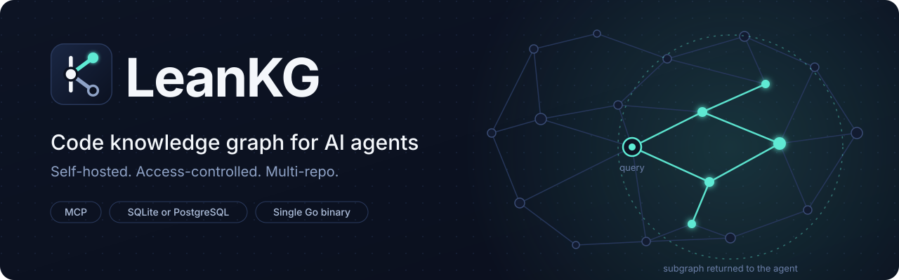

<p align="center">
  
</p>

<h1 align="center">LeanKG</h1>

<p align="center">
  <strong>Every code-graph answer says which rung it came from, how fresh it is, and whether you are allowed to see it.</strong><br>
  A self-hosted code knowledge graph for AI coding agents, for engineering organizations whose agents must answer from the real codebase under their own access rules.
</p>

<p align="center">
  <a href="https://leankg.onrender.com"><strong>Live Demo</strong></a>
  &nbsp;&middot;&nbsp;
  <a href="docs/prd.md"><strong>Docs</strong></a>
  &nbsp;&middot;&nbsp;
  <a href="#get-started"><strong>Get Started</strong></a>
  &nbsp;&middot;&nbsp;
  <a href="#enterprise-readiness"><strong>Enterprise</strong></a>
  &nbsp;&middot;&nbsp;
  <a href="CHANGELOG.md"><strong>Changelog</strong></a>
</p>

<p align="center">
  <a href="https://github.com/FreePeak/LeanKG/releases/latest"></a>
  <a href="https://pkg.go.dev/github.com/FreePeak/LeanKG"></a>
  <a href="LICENSE"></a>
</p>

<p align="center">
  
  
  
  
  
</p>

<p align="center">
  
</p>

---

## Why LeanKG

- **Provenance on every code-graph answer.** A `query` answer names the retrieval rung it came from (`retrieval.rung`, `retrieval.reason`) and how fresh the index is: `freshness` (`cold`, `fresh` or `possibly_stale`), `indexed_at`, and `head_sync` on a git-indexed store. A consumer can tell an exact match from a fallback and a current index from a stale one. The ontology, session, prd, incidents, env_conflicts, service_context, compress and languages actions carry no retrieval, and a portfolio fan-out has none at the top level (each child answer has its own); see [the tool contract](docs/mcp-tool-contract.md).
- **Per-project access.** A bearer token can be limited to named projects with `project:<name>` scopes, and the grant is checked on MCP, REST, auto-config, the dashboard API and project switcher, RPC and portfolio reads. A restricted token lists and revokes only its own token, and cannot create orgs or claim resources. Every query answer's `access` block states the role and project the caller was served as. Viewer, Contributor and Admin roles are declared per HTTP route, and a non-loopback bind is refused without a token.
- **Several repositories, one server.** `LEANKG_PROJECT_DIRS` registers several repositories in one process. Each request selects its project, and a portfolio query skips the projects the caller cannot see.
- **Deployment control.** One CGO-free binary and a container image. SQLite needs no database server. PostgreSQL with pgvector is the opt-in for shared, server-scale deployments.
- **Lower agent cost.** Agents ask for a targeted subgraph (callers, dependents, impact, tests, docs) instead of running grep-and-read loops over whole files. The archived A/B figures are in [Performance](#performance); they have not been re-run on the Go engine.

A real `query` answer, trimmed to the provenance keys (hits, query and limit omitted). It is the output of `leankg query -action exact Greet` on a three-function Go fixture indexed in a git repository, run through the CLI, which calls the same engine as the MCP tool. `indexed_at` is a unix time and differs on each index run.

```json
{
  "access": {
    "project": "fixture-repo",
    "restricted": false,
    "role": "admin",
    "via": "local"
  },
  "freshness": "fresh",
  "head_sync": "match",
  "indexed_at": 1795510603,
  "retrieval": {
    "reason": "exact identifier match",
    "rung": "L1",
    "scope": "all"
  }
}
```

| Without a code graph | With LeanKG |
| -------------------- | ----------- |
| Many tool calls and large context windows | A targeted subgraph per question |
| No blast radius before a change | Impact analysis (breadth-first search over `contains`, `calls` and `imports` edges) |
| Keyword search only | Exact, keyword, and semantic ladder; degrades to what is indexed when vectors are missing |
| One repository at a time | Multi-project server; each request selects its project |
| Open access to the code graph | Bearer tokens, role floors per route, refusal of unauthenticated non-loopback binds |

## Comparison with context-mode (2026-11-24)

Source: the public README of [context-mode](https://github.com/mksglu/context-mode), read as of 2026-11-24. This is not a code audit of context-mode. "Not documented" means that README is silent on the point.

| Capability | LeanKG | context-mode |
| ---------- | ------ | ------------ |
| Provenance per answer | Every answer carries `access`. Index-backed answers carry `retrieval{rung,reason}`, naming the rung (L0-L3, ast-grep, lsp, graph, memory, git) | Search hits show the source file and heading |
| Per-answer freshness | `freshness` (`cold`, `fresh`, `possibly_stale`), `indexed_at` and `head_sync` (`match`, `stale`, `unknown`) on index-backed answers | Not documented for indexed content |
| Role/ACL on reads | Viewer, Contributor and Admin roles per route; `project:<name>` grants enforced on the routed surfaces; RPC has no grant check of its own and refuses a token that lacks the default project | Not documented. The README mentions a PreToolUse deny list, not read roles |
| Multi-project from one server | `LEANKG_PROJECT_DIRS` serves several repositories from one process; each request selects one | One `context.db` per project under `~/.context-mode`; serving several projects from one server is not documented |
| Measured answer quality | No quality figure published yet; the judge-blind run in [`benchmarks/cross_tool`](benchmarks/cross_tool) is pending | Not documented. It reports bytes-based reduction (`ctx_bytes` against `raw_bytes`) |

## At a glance

| Area | Value | Evidence |
| ---- | ----- | -------- |
| Language profiles | **40** | [`internal/langs/langs.go`](internal/langs/langs.go#L134-L261) (`Default` profile table) |
| MCP tools | **4**: `import`, `query`, `status`, `authenticate` | [`AGENTS.md`](AGENTS.md#auth-and-the-http-gate), [`internal/mcp/server.go`](internal/mcp/server.go) |
| Access roles | **3**: Viewer, Contributor, Admin | [`internal/auth/auth.go`](internal/auth/auth.go#L22-L31) |
| Storage engines | **2**: SQLite (default), PostgreSQL + pgvector (opt-in) | [`internal/store/roles.go`](internal/store/roles.go), [`docs/prd.md`](docs/prd.md) |
| Embedding providers | **3**: `local` (default), `openai`, `deterministic` (tests) | [`internal/embed/config.go`](internal/embed/config.go#L23-L25) |
| Transports | MCP (stdio, streamable HTTP), REST, ConnectRPC (gRPC, gRPC-Web, JSON), web UI | `leankg serve --help` (see [CLI reference](#cli-reference)) |
| Agent client targets | **6** JSON-config clients (`claude-code`, `cursor`, `codex`, `gemini`, `opencode`, `omp`) plus an `xdev` YAML target | [`cmd/leankg/connect.go`](cmd/leankg/connect.go#L34-L45) |
| Release binaries | linux and darwin, amd64 and arm64, each with a `.sha256` | [`.github/workflows/release.yml`](.github/workflows/release.yml#L109-L112) |

## Get Started

Three commands take a repository from nothing to an agent that can query it.

```bash
# 1. Install the CLI and server (or use a prebuilt archive, see Installation)
go install github.com/FreePeak/LeanKG/cmd/leankg@latest

# 2. Index the repository. Writes .leankg/leankg.db (SQLite). In a git repo root,
#    the HEAD commit's objects are read, so uncommitted and ignored files are not indexed.
cd your-project
leankg index .

# 3. Wire an AI client: claude-code | cursor | codex | gemini | opencode | omp
leankg install --target claude-code
```

Restart the client so it picks up the new MCP entry. The stdio entry is `serve --stdio --memory`, which gives the agent the code graph and the markdown memory layer (per project, at `<project>/.leankg/memory`) in one server.

**Serve over HTTP instead** (one server, many clients):

```bash
leankg serve --http 127.0.0.1:9699 --rest 127.0.0.1:8080 --memory
leankg install --target claude-code --http --url http://127.0.0.1:9699/mcp
```

MCP is served at `/mcp`; `GET /health` returns 200 when the server is ready. The HTTP server resolves its project from the process working directory, or from `--project DIR`.

**Semantic search (optional).** Exact and keyword matches work with no extra setup. Semantic (L3) search needs embeddings: set `LEANKG_EMBED_PROVIDER` (see [docs/embedding.md](docs/embedding.md) and [`.env.example`](.env.example)). `leankg index` then embeds incrementally after indexing; an embedding failure is reported and does not fail the index.

**Self-check any deployment:** `leankg doctor` prints the store path, element and file counts, and the write watermark (exit 0 pass, 2 fail). `leankg doctor --deep` runs the extended checks.

## Enterprise readiness

The table lists only capabilities that exist in this repository today. Each row links to the code that implements it. Items that are not implemented are listed under [Current limits for enterprise evaluation](#current-limits-for-enterprise-evaluation) rather than omitted.

### Security and access control

| Capability | How it works | Evidence |
| ---------- | ------------ | -------- |
| Role model | Viewer (read), Contributor (writes such as import and memory writes), Admin (management actions) | [`internal/auth/auth.go`](internal/auth/auth.go#L22-L31) |
| Role floors per route | Every route on a gated listener declares its role at registration: `auth.Require(role, h)` or `auth.Public(h)`. Example: the ontology match write requires Contributor | [`internal/auth/route.go`](internal/auth/route.go#L27-L31), [`internal/rest/rest.go`](internal/rest/rest.go#L94) |
| Bearer tokens | Opaque `lkg_...` secrets sent as `Authorization: Bearer`; optional expiry; revocable. Created and revoked with `leankg auth token create` and `leankg auth token revoke` | [`internal/auth/tokens.go`](internal/auth/tokens.go#L15-L26), [`cmd/leankg/auth.go`](cmd/leankg/auth.go#L217-L221) |
| Admin bootstrap | `leankg auth admin init` creates one site-admin account; the database stores only the PBKDF2 password hash, and credentials are written to a 0600 env file | [`cmd/leankg/auth.go`](cmd/leankg/auth.go#L47), [`AGENTS.md`](AGENTS.md#auth-and-the-http-gate) |
| Password storage | PBKDF2-HMAC-SHA256 at 600,000 iterations (standard library) | [`internal/auth/accounts.go`](internal/auth/accounts.go#L36-L38) |
| Login throttling | After 5 consecutive failures for a username, `authenticate` locks that username out for 60 seconds | [`internal/auth/login_throttle.go`](internal/auth/login_throttle.go#L13-L14) |
| Exposure guard | `serve --http`, `--rest` or `--rpc` on a non-loopback address exits with an error unless a bearer token is configured. The check is shared by all listeners | [`cmd/leankg/main.go`](cmd/leankg/main.go#L364), [`internal/servebind/servebind.go`](internal/servebind/servebind.go#L85) |
| Read-only serving | `serve --read-only` opens the store read-only and skips migrations. A mutating call returns the stable error code `LEANKG_ERROR_READ_ONLY` | [`cmd/leankg/main.go`](cmd/leankg/main.go#L330), [`cmd/leankg/main.go`](cmd/leankg/main.go#L422), [`internal/errs/errs.go`](internal/errs/errs.go#L133-L137) |
| Per-project grants | A token minted with `project:<name>` scopes reaches only the named projects. A token minted through the HTTP endpoint inherits its caller's `project:` scopes. A project it does not cover is refused with the same error whether or not the project exists. Unscoped tokens are unrestricted for projects. A basename shared by two registered projects is refused to restricted tokens. Mint one with `leankg auth token create --name ci-alpha --role viewer --scopes project:alpha` | [`AGENTS.md`](AGENTS.md#auth-and-the-http-gate), [`internal/projects/projects.go`](internal/projects/projects.go#L312), [`cmd/leankg/auth.go`](cmd/leankg/auth.go#L282) |

### Scale and multi-repo

| Capability | How it works | Evidence |
| ---------- | ------------ | -------- |
| Multi-project server | `LEANKG_PROJECT_DIRS` registers several repositories; REST and MCP requests select one with `?project=<dir or name>` or the MCP `project` argument | [`cmd/leankg/main.go`](cmd/leankg/main.go#L244), [`internal/web/api.go`](internal/web/api.go#L60) |
| Fail-closed project selection | On a multi-project server, the MCP `project` argument is required, and the server refuses to guess which graph a question is about | [`internal/mcp/server.go`](internal/mcp/server.go#L352-L359) |
| Shared database backend | PostgreSQL with pgvector (`LEANKG_DB_ENGINE=postgres`, `LEANKG_PG_URL`), schema per project, per-model HNSW vector index | [`docs/prd.md`](docs/prd.md) (Storage line), [`internal/store/store_pg.go`](internal/store/store_pg.go#L64-L69) |
| Per-repository stores | SQLite (WAL) store per repository at `.leankg/leankg.db`, no server process | [`docs/prd.md`](docs/prd.md) (Storage line) |

### Deployment and operations

| Capability | How it works | Evidence |
| ---------- | ------------ | -------- |
| Single binary | CGO-free build (`CGO_ENABLED=0`), no runtime dependencies. Builds `leankg` and `leankg-embed` | [`Makefile`](Makefile#L22), [`Dockerfile`](Dockerfile#L13) |
| Container image | Three-stage build; runs as an unprivileged user (uid 10001); `HEALTHCHECK` on `/health`. The published image serves a read-only demo graph | [`Dockerfile`](Dockerfile#L41-L53) |
| Health endpoint | `GET /health` on the HTTP listeners, registered as a public route (no role floor) | [`cmd/leankg/main.go`](cmd/leankg/main.go#L679) |
| Diagnostics | `leankg doctor` (with `--deep` and `--format text\|json`) and `leankg status` report store path, inventory, freshness and embedding state | [`cmd/leankg/main.go`](cmd/leankg/main.go#L227) |
| Self-update channel | `leankg update` follows the published GitHub releases (`leankg update [--check]`) | [`cmd/leankg/main.go`](cmd/leankg/main.go#L229) |
| Telemetry | Capture is off by default and needs explicit consent in `telemetry.yaml` | [`internal/telemetry/config.go`](internal/telemetry/config.go#L14-L16) |
| Embedding providers | `local` (llama.cpp sidecar, default), `openai` (any OpenAI-compatible API), `deterministic` (tests only). Each vector writer is model-stamp guarded, so a model change fails loudly instead of mixing vector spaces | [`internal/embed/config.go`](internal/embed/config.go#L23-L25), [`docs/embedding.md`](docs/embedding.md) |

### Governance and traceability

| Capability | How it works | Evidence |
| ---------- | ------------ | -------- |
| Incidents and ownership | `leankg incident add \| list \| show`, `leankg team-map`, `leankg note`; queryable with `query --action incidents` and `service_context` | [`cmd/leankg/main.go`](cmd/leankg/main.go#L115-L119) |
| Environment governance | `leankg env-conflicts --service NAME` and `query --action env_conflicts` report configuration conflicts across environments; `--env` on notes and service context selects the environment | [`cmd/leankg/main.go`](cmd/leankg/main.go#L117), [`internal/core/actions.go`](internal/core/actions.go#L115) |
| Requirement traceability | `leankg prd` ingests a PRD and `leankg prd-trace <FEATURE_ID>` traces a requirement to code; `query --action prd` | [`cmd/leankg/main.go`](cmd/leankg/main.go#L109) |
| Ontology | Concept catalog and workflows shipped in [`ontology/`](ontology/); the match API is `POST /api/v1/ontology/match` | [`internal/rest/rest.go`](internal/rest/rest.go#L94), [`AGENTS.md`](AGENTS.md#self-ontology-ontology) |
| Secret redaction | A shared redaction helper (`telemetry.Redact`) is used by the memory and session-link code paths to scrub secrets from stored text | [`internal/memory/memory.go`](internal/memory/memory.go#L449), [`internal/sessionlink/runner.go`](internal/sessionlink/runner.go#L150) |

### Current limits for enterprise evaluation

These are the gaps a buyer is likely to ask about. None of them is claimed as implemented.

- **No SSO.** There is no OIDC, SAML or SCIM integration in the repository. Users are local accounts with bearer tokens.
- **No TLS in the server.** The HTTP, REST and RPC listeners do not terminate TLS. Put them behind a TLS-terminating reverse proxy.
- **Audit ledger is not wired.** The store has a hash-chained audit ledger, and `leankg audit export` and `leankg audit verify` read and check it. The Go runtime does not append events to it yet: `AppendAudit` is called only from tests ([`internal/store/store_audit.go`](internal/store/store_audit.go#L36), [`cmd/leankg/audit.go`](cmd/leankg/audit.go#L26)).
- **No encryption at rest by LeanKG.** The SQLite store and the PostgreSQL schema are not encrypted by the application. Use disk or database encryption.
- **No SIEM export, no compliance attestations.** This repository makes no SOC 2, ISO 27001 or GDPR claim.
- **No hosted service.** This repository ships software only. Deployments are self-hosted.
- **stdio is not gated.** The stdio transport is a local subprocess and runs as Admin ([`AGENTS.md`](AGENTS.md#auth-and-the-http-gate)).

## How it works

LeanKG indexes a repository into a graph of elements (files, functions, types, modules) and their relationships (`contains`, `calls`, `imports`, `references`). Extraction uses a regex tier that is always available; a tree-sitter tier is built behind the `tstree` build tag, and ast-grep is used when its CLI is on `PATH`. Language servers, when configured, start lazily at query time and stop after an idle TTL.

Queries go down a ladder. L1 is an exact identifier match. L2 is keyword and fuzzy matching (FTS5 on SQLite, full-text on PostgreSQL). L3 is semantic search over embeddings, with keyword and vector ranks fused by reciprocal rank fusion. A natural-language question starts at L3 when L1 misses. If a rung is unavailable (for example, no embeddings yet), the answer comes from the next rung down and says so in `retrieval`.

Every transport calls the same core. The stdio and HTTP MCP servers, the REST API, the ConnectRPC service and the web UI are thin layers over one engine, so the same question gets the same answer whichever door it came through. The team layer (memory, incidents, ownership, environments, requirements) lives in the same store as the code graph.

## Supported AI clients and MCP surface

The MCP surface is four tools. Discovery goes through `query`, which routes the ladder by default.

| Question | Call |
| -------- | ---- |
| Any identifier (default) | `query "parseConfig"` (exact, then fuzzy) |
| Who calls X? | `query --action callers --to <qualified-name>` |
| Blast radius of a change | `leankg impact <file>` or `query --action impact --to <qualified-name>` |
| How does A reach B? | `query --action path --to <qualified-name>` |
| Element details | `query --action explain --to <qualified-name>` |
| Pattern search | `query --action pattern --pattern "func $_(...)"` |
| Requirement trace | `leankg prd-trace FR-3T-01` |
| Read a file (compressed) | `query --action read --path src/main.go` |
| Session start memory | `query` with `action=memory`, `args.command=session_recall` |
| Session end retain | `import` with `action=memory`, `command=session_retain` |
| Health and freshness | `status` |
| Log in over HTTP | `authenticate` (returns a bearer token; the HTTP gate needs it for `import`, `query` and `status`) |

Client wiring is one command per client: `leankg install --target <client>` (or `leankg connect <client>`, the same writer). Add `--http --url <url>` for an HTTP entry.

## Deployment models

| Model | What it is | Notes |
| ----- | ---------- | ----- |
| Developer or CI | The `leankg` binary with a SQLite store per repository | No database server, no Docker |
| Shared team server (self-hosted) | `leankg serve --http`, `--rest`, `--rpc` behind bearer tokens, with `--read-only` for reader instances and `LEANKG_PROJECT_DIRS` for several repositories | Non-loopback binds need a token. Put TLS in front of it |
| Shared database | PostgreSQL with pgvector (`LEANKG_DB_ENGINE=postgres`, `LEANKG_PG_URL`) | Opt-in; the default flow does not touch PostgreSQL |
| Container | [`Dockerfile`](Dockerfile) builds a read-only demo image | This is the image behind the public demo. It is not a production deployment template |
| Hosted or managed | Not provided by this repository | |

## Performance

**Archived, not re-run.** The A/B table below was measured on the archived Rust-era vector-engine gate and has not been re-run against the Go engine. The cold time-to-first-value row is a Go CI budget measurement and is kept as recorded. For the current cross-tool benchmark, see [`benchmarks/cross_tool`](benchmarks/cross_tool): three arms (baseline, context-mode and leankg), commit SHAs pinned in `repos.lock.yaml` and `tools.lock.yaml`, a dry-run gate that `make bench-cross-tool` runs by default, a three-arm report that keeps the losing rows, and judge-blind answer-quality scoring. No real run has been made and no results are checked in. A real run needs a pinned model id, Node 24.15 or newer and a context-mode install, and it spends API budget (see [RUNNING.md](benchmarks/cross_tool/RUNNING.md)). No performance figure is stated here.

| Metric | Result | Source |
| ------ | ------ | ------ |
| Input tokens | -65.0% | [docs/archive/prd.md](docs/archive/prd.md) line 597 (100 tasks, A/B) |
| Tool calls | -84.6% | [docs/archive/prd.md](docs/archive/prd.md) line 597 (100 tasks, A/B) |
| Speedup for agents | 2.50x | [docs/archive/prd.md](docs/archive/prd.md) line 597 (100 tasks, A/B) |
| Cold time-to-first-value (Go) | 17.8 s with a cold build cache, on the project's macOS ARM64 self-hosted runner; CI budget 300 s | [`.github/workflows/ci.yml`](.github/workflows/ci.yml#L218), [docs/prd.md](docs/prd.md) row #280 (warm 4.9 s; fully cold 21.6 s) |

Further analyses are archived: [competitive analysis](docs/archive/competitive-analysis.md), [ROI comparison](docs/archive/reports/leankg-vs-graphify-company-roi-2026-07-21.md), [research matrix](docs/archive/analysis/leankg-competitive-research-and-improvement-strategy-2026-08-02.md).

## Languages

**40 language profiles** are registered in the engine. Every profile gets the regex extractor. Tree-sitter, ast-grep and language-server tiers apply where available (see [`internal/langs/langs.go`](internal/langs/langs.go#L134-L261)).

<details>
<summary>All 40 profiles</summary>

Go, Rust, TypeScript, TSX, JavaScript, JSX, Python, Markdown, Java, Kotlin, Swift, Objective-C, Dart (Flutter), C, C++, C#, PHP, Ruby, Scala, Perl, Lua, Haskell, Elixir, Crystal, CUDA, Cypher, Elm, Erlang, F#, GLSL, HLSL, Nim, OCaml, SQL (PostgreSQL, T-SQL and PL/SQL dialects), PowerShell, Q#, Solidity, SystemVerilog, Verilog, Zig

</details>

## CLI reference

Full usage: `leankg help` or `leankg <command> --help`.

<details>
<summary>Common commands</summary>

```bash
leankg index .                          # index + incremental embed -> .leankg/leankg.db (--no-embed skips the embed)
leankg index <dir> --hook               # SessionStart mode: skips over LEANKG_HOOK_MAX_FILES (10000) files or LEANKG_HOOK_MAX_EMBED (500) elements needing vectors
leankg writer --project <dir>           # index once, then watch; a git-backed store re-indexes on each new commit
leankg query "parseConfig"              # name lookup (exact, then fuzzy), JSON output
leankg query "parseConfig" --compress   # one line per result
leankg impact src/main.go --depth 3     # blast radius of a file or element
leankg status                           # health, inventory, freshness, embed state
leankg doctor                           # store path, element and file counts, watermark
leankg install --target cursor          # client wiring (--register-cwd adds an async claude-code SessionStart hook)
leankg serve --stdio                    # MCP over stdio (what harnesses spawn)
leankg serve --http 127.0.0.1:9699      # MCP over streamable HTTP (/mcp, /health)
leankg serve --rest 127.0.0.1:8080      # REST API (/health, /api/v1/*)
leankg serve --rpc 127.0.0.1:9090       # ConnectRPC (gRPC + gRPC-Web + JSON)
leankg serve --ui 127.0.0.1:8081        # embedded dashboard (its /api/* data API is served here)
leankg serve --read-only                # reader role: store opened read-only
leankg auth token create                # mint a bearer token
leankg auth admin init                  # create the site-admin account (writes LEANKG_ADMIN_* to .env)
leankg audit export | verify            # read and check the audit ledger (see Current limits)
leankg prd --source docs/prd.md         # ingest requirements
leankg prd-trace FR-3T-01               # trace a requirement to code
leankg incident add | list | show       # incidents
leankg team-map                         # ownership map
leankg update --check                   # check for a newer release
leankg version
```

</details>

<details>
<summary>Embedding commands</summary>

```bash
leankg-embed run                        # incremental embed
leankg-embed full                       # stamp-guarded full rebuild (after a model or stamp change)
leankg-embed status
leankg-embed export | import            # NDJSON offsite flow (pairs with scripts/hf-embed.sh)
```

</details>

**A non-loopback bind is refused.** `leankg serve --http/--rest/--rpc <non-loopback>` exits with an error unless a bearer token is configured. With no token configured, every caller would resolve to Admin, which would expose the project graph, the file reader and the memory write path to the network. Either bind a loopback address (the default), or configure a token first with `leankg auth token create`, or with `LEANKG_TOKEN_ADMIN`, `LEANKG_TOKEN_CONTRIBUTOR` or `LEANKG_TOKEN_VIEWER`. A configured site-admin account also counts as a token. See [Auth and the HTTP gate](AGENTS.md#auth-and-the-http-gate).

**Authentication flow.** A client calls `authenticate` with `{"username": ..., "password": ...}` and receives `{"token": "lkg_...", "role": "admin", "expires_at": "<RFC3339>"}`. Later requests send `Authorization: Bearer <token>`. With the gate on, a request with no `Authorization` header can reach only the protocol handshake, `tools/list`, and `authenticate`. A request with an invalid or expired token gets HTTP 401. The REST and ConnectRPC surfaces have no login tool, so they need a token minted with `leankg auth token create`.

**Environment variables.** `LEANKG_DB_ENGINE` and `LEANKG_PG_URL` select the store. `LEANKG_PROJECT_DIRS` registers several projects. `LEANKG_EMBED_PROVIDER` and `LEANKG_EMBED_*` configure embeddings. `LEANKG_TOKEN_ADMIN`, `LEANKG_TOKEN_CONTRIBUTOR` and `LEANKG_TOKEN_VIEWER` configure bearer tokens. The full list, with examples, is in [`.env.example`](.env.example).

## Installation

**Prebuilt archives.** [Releases](https://github.com/FreePeak/LeanKG/releases/latest) carry `leankg-<os>-<arch>.tgz` for linux and darwin on amd64 and arm64. Each archive holds both binaries at its root, with a `.sha256` file alongside. `leankg update` follows the same channel.

**Go toolchain.** Requires Go 1.25+:

```bash
go install github.com/FreePeak/LeanKG/cmd/leankg@latest         # server and CLI
go install github.com/FreePeak/LeanKG/cmd/leankg-embed@latest   # embedding pipeline
```

**From a checkout.** Requires Go 1.25+ and git. Installs to `~/.local/bin` by default; pass a `PREFIX` to change it:

```bash
git clone https://github.com/FreePeak/LeanKG.git && cd LeanKG
scripts/install-go.sh                # or: make install-go
```

**Container.** [`Dockerfile`](Dockerfile) builds the demo image (see [Deployment models](#deployment-models)):

```bash
docker build -t leankg .
docker run --rm -p 8080:10000 -e PORT=10000 leankg   # dashboard and its /api on :8080
```

## Known limits

- **Call edges are resolved by name within a directory.** There is no import or type resolution, so a same-name call in the same directory resolves, and cross-package dispatch is best-effort. The upgrade path is tree-sitter symbol tables. See [`internal/index/relations.go`](internal/index/relations.go#L30-L39).
- **Heuristic guards** in the indexer: files of 1 MiB or more are skipped as vendored or minified bundles ([`internal/index/index.go`](internal/index/index.go#L104)); call targets shorter than 4 characters are dropped as noise, and outgoing calls are capped per element (40) and per file (500) ([`internal/index/relations.go`](internal/index/relations.go#L51-L53)).
- **The unit of scope is a repository.** A portfolio root (tens of thousands of nested files) is not a project; register its child repositories one at a time.
- **With no token configured, `--ui` binds an unauthenticated data API** (query, read and import routes). Bind it to loopback or front it with a proxy. The public demo container serves it `--read-only` against a disposable baked graph. Its `/api/file` reader needs a Viewer token when the gate is on, and answers 403 on a non-loopback bind when the gate is off.
- **Dashboard API and the auth gate.** With the gate on, the dashboard shell loads but its `/api/` calls return 401, because the bundled UI sends no `Authorization` header.
- **Project-scoped tokens and RPC.** A token scoped to a project other than the default gets no RPC access. The check fails closed with 403. The RPC listener's `/health` still answers 200 to any valid token, while REST `/health` returns 403 for a restricted token that lacks the default project.

## Troubleshooting

| Issue | Fix |
| ----- | --- |
| Wrong project served | Start the server with `--project DIR` (`query` and `impact` also honor `LEANKG_PROJECT`) |
| Embeddings or a cold embed | `leankg-embed status`, then `leankg-embed full`. Provider variables are `LEANKG_EMBED_*` |
| `LEANKG_ERROR_READ_ONLY` | The server was started with `--read-only`. Restart it without the flag, or send writes to a writable instance |
| Server refuses to start on a non-loopback address | Bind `127.0.0.1` (the default), or configure a bearer token first (`leankg auth token create`) |
| Query on a multi-project server is refused | Pass the `project` argument (a directory or a project name) on each call |

**Requirements:** macOS or Linux. Go 1.25+ is needed only when building from source. No Docker and no PostgreSQL are needed for the default SQLite store.

## Documentation

The documentation set lives in [`docs/`](docs/): a single unified PRD ([`docs/prd.md`](docs/prd.md)) and task tracker ([`docs/prd-task-tracker.md`](docs/prd-task-tracker.md)). Historical design documents, analyses, reports and plans are preserved under [`docs/archive/`](docs/archive/).

| Document | Contents |
| -------- | -------- |
| [PRD](docs/prd.md) | Unified product requirements and high-level design (single source of truth) |
| [Task tracker](docs/prd-task-tracker.md) | Done, in progress, to do |
| [Embeddings](docs/embedding.md) | Providers, EmbeddingGemma 2 bulk path, variable list |
| [Telemetry](docs/telemetry.md) | Consent-gated capture and transcript linking |
| [Architecture (archived)](docs/archive/architecture.md) | Design and data model (historical) |
| [MCP tools (archived)](docs/archive/mcp-tools.md) | Tool catalog (historical) |
| [CLI (archived)](docs/archive/cli-reference.md) | All commands (historical) |
| [Benchmarks (archived)](docs/archive/benchmark.md) | Methodology (historical) |
| [AGENTS.md](AGENTS.md) | Agent context, build and test commands, auth model |
| [Security policy](SECURITY.md) | How to report a vulnerability |

## Enterprise contact

[Contact placeholder - replace with sales email or form URL]

## Contributing

1. Fork, then work on a feature branch (a git worktree is preferred).
2. Update the docs when behavior changes: [`docs/prd.md`](docs/prd.md) and [`docs/prd-task-tracker.md`](docs/prd-task-tracker.md).
3. Run `make go-build`, `make go-test` and `make go-vet`. Storage-layer changes also need `make dual-engine`, which needs a PostgreSQL with pgvector on port 5433.
4. Open a pull request with a summary and a test plan. The `main` branch is protected and changes land through pull requests.

See [CONTRIBUTING.md](CONTRIBUTING.md) and [CODE_OF_CONDUCT.md](CODE_OF_CONDUCT.md).

## License

[Apache License 2.0](LICENSE)
