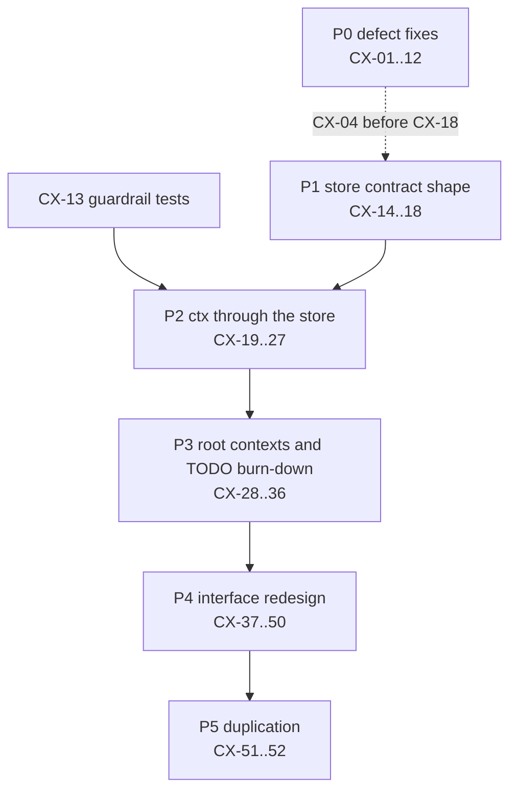
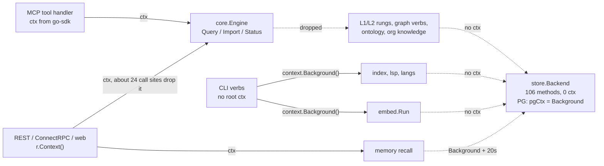

# Plan: context propagation and interface redesign

**Status:** IN PROGRESS (2026-11-13): CX-13 is in a PR; the rest is not started · **Tracks:** [plan-context-and-interfaces-refactor-tracker.md](plan-context-and-interfaces-refactor-tracker.md) (`CX-01..CX-52`) · **Base:** `6b4b741e`
**Source:** a static review of the whole module on 2026-11-13. An AST scan of the 326 non-test, non-generated Go files produced the counts below; a per-package read of every slice (store; core/graph/mcp; rest/rpc/web/dashboard/auth; index/docindex/prdindex/langs/ontology/tstree; embed/memory; cmd/telemetry/sessionlink/update; the remaining packages) produced the findings. Findings marked **verified** were re-read line by line while writing this plan; the rest come from the per-package review and are re-confirmed by the failing test that opens each PR. Nothing here was reproduced against a running server.

This is the working plan for one programme of waves. When a phase lands, its outcome moves into the PRD changelog; when the last phase lands, this file moves to `docs/archive/`.

---

## 0. Summary

**Why almost no function takes a `context.Context`:** the storage contract never had one. `store.Backend` was ported one-to-one from the Rust engine's signatures, which carried no context, so all 106 of its methods are ctx-less, and PostgreSQL papers over it with a package-level `context.Background()`. With nothing to pass to, every layer above dropped ctx too; ctx only appears in islands where something below needed it (the embedder HTTP call, the telemetry ledger, git exec). Nothing in CI stops new ctx-less I/O, so the gap grows with each feature. The bad interfaces have the same root: one parity-shaped god interface, with every missing capability bolted on as a type assertion instead of being added to a contract.

Baseline (main module, `examples/` excluded):

| Metric | Value |
|---|---|
| Functions and methods (non-test) | 2899 |
| ... that take a `context.Context` | 253 (8.7%) |
| `internal/store` functions that take ctx | 4 of 362 |
| `store.Backend` methods / with ctx | 106 / 0 |
| SQLite-side `database/sql` calls using a `*Context` variant | 0 of 153 (Exec 69, QueryRow 41, Query 30, Begin 13) |
| `context.Background()` / `context.TODO()` in non-test code | 32 in library packages, 45 in `package main` |
| Interfaces declared | 28; the only multi-method domain interface that is ctx-first throughout is `telemetry.Store` |
| Store capability type assertions in consumers | 7 (`core/core.go:508,1087,1186,1194,2305`, `orgknowledge/notes.go:117`, `maintain/reconcile.go:71`) |

Programme at a glance:

| Phase | IDs | What | Behaviour change |
|---|---|---|---|
| P0 | CX-01..12 | Fix the defects found during the analysis (security and correctness) | yes, each one a `fix:` PR |
| P1 | CX-13..18 | Guardrail tests; reshape the store contract into roles; capabilities become contract | only CX-16 (PG filters before LIMIT) |
| P2 | CX-19..27 | ctx through the store, one role per PR, bottom-up; delete `pgCtx` | no |
| P3 | CX-28..36 | Root contexts at every entry point; burn down every `context.TODO()` top-down | cancellation starts working |
| P4 | CX-37..50 | Interface redesign beyond ctx: narrow dependencies, embed identity, typed core actions, one transport service layer, route-level auth | small, each one documented |
| P5 | CX-51..52 | Remove duplicated SQLite/PG logic; optional per-file unit of work | no |

Start with CX-01 and CX-02 (security) and CX-13 (guardrails) in parallel, then CX-14. P2 cannot start before CX-13 and CX-14 have merged.

## 1. Root cause: why the context is missing

1. **The bottom layer has no ctx, by inheritance.** `store.Backend` (`internal/store/backend.go:20-253`) mirrors the Rust engine's storage calls; its comments cite the parity source per block (`:150` "FR parity with the Rust audit/mod.rs", `:155` "Rust auth/tokens.rs parity", `:169`, `:191`, `:223`). The Rust signatures had no cancellation parameter, so none of the 106 Go methods got a ctx. **verified**
2. **PostgreSQL throws away the ctx it is given.** `OpenPG` receives a ctx and uses it only to build the pool (`store/store_pg.go:52-85`). Every statement after that runs on `var pgCtx = context.Background()`, whose own comment reads "pgCtx backs Backend methods, which carry no context parameter" (`store/store_pg.go:23-24`). pgx accepts a ctx on every call: the engine is cancellable, the contract is not. **verified**
3. **The middle layers dropped ctx because there was nowhere to pass it.** The MCP handler's ctx reaches `core.Engine.Query` (`mcp/server.go:599-609`) and dies at the first rung: `rungExact` and `rungFuzzy` take no ctx (`core/core.go:1062,1083`, **verified**); `graphAction(ctx, ...)` never reads its ctx and the `graph.*` verbs take none (`core/core.go:1528`, `graph/graph.go:70-290`).
4. **ctx was then added locally, which created islands.** Where something below needed it (embed HTTP `embed/openai.go:100`, git exec `gitobj/gitobj.go:231`, the telemetry ledger `telemetry/types.go:305-327`), ctx was added at that spot only. `rungSemantic` passes ctx to the embedder and not to the vector scan beside it (`core/core.go:1126-1227`). The memory package grew 10 `XxxCtx` methods next to 10 ctx-less wrappers that call `context.Background()` (`memory/banks.go:213,269,336,367,410,444,739,753,766`, `memory/scope.go:96`); the wrappers have no production caller left, yet nothing removed them.
5. **The roots never create a ctx.** `main()` builds no root context (`cmd/leankg/main.go:55-181`); none of the 61 `cmd*` functions takes one; `leankg index` has no signal handler and runs on `context.Background()` (`cmd/leankg/helpers.go:208,226,241,250,272`). So even code that accepts ctx usually receives `Background`.
6. **Nothing prevents a regression.** No lint, vet check or test fails on a new ctx-less I/O function, a new `context.Background()` in a library package, or a new `exec.Command`. Every new feature copies the shape of its neighbours.
7. **The interface problems share the root.** The single parity-shaped interface became the place every new table landed (tokens, accounts, orgs, incidents, metrics, projects, summaries: 17 role clusters). Capabilities it lacked were bolted on as type assertions (`core/core.go:508,1087,1186,1194,2305`) instead of being added to the contract, and SQLite mechanics leaked into the "neutral" contract (`store/backend.go:62-85`).

## 2. Findings

### 2.1 Where the context dies, per entry point

| Entry point | Where ctx dies | Consequence | Evidence |
|---|---|---|---|
| `leankg index` / `--hook` | the verb never creates one; Background everywhere | Ctrl-C kills the process mid-write and skips the deferred unlock and Close; the hook has size gates but no time budget | `cmd/leankg/main.go:1017`; `cmd/leankg/helpers.go:94-150,208,226,272` |
| `leankg serve` | auto-index drops its ctx before `runIndex`; listeners are never joined | SIGTERM cannot stop auto-index; `cmdServe` returns while `Shutdown` is in flight and the deferred `st.Close` races the handlers | `cmd/leankg/setup_serve.go:26,55`; `cmd/leankg/main.go:602,628,648,699,701`; `cmd/leankg/helpers.go:36-47` **verified** |
| `leankg-embed` | store calls inside `Run`; export/import use Background | a cancel lands only between batches; Ctrl-C on the last batch can exit 0 as `partial`; `log.Fatalf` skips defers and orphans the sidecar | `embed/run.go:278-388,489-547`; `cmd/leankg-embed/main.go:197,202,237,273` |
| MCP `query` | `rungExact`, `rungFuzzy`, the vector scan, `graph.*` | a disconnected client's L2/L3 scans and graph BFS run to completion | `core/core.go:1062,1083,1143,1199,1227,1528` |
| MCP `status` | the embed health probe makes its own Background, 3 s, under a mutex | status calls serialize behind one probe | `core/embedhealth.go:22-31` |
| REST / ConnectRPC | about 24 call sites below the handler (session read, ontology, org knowledge, hindsight stats/list/by-id) | uncancellable reads after the client has gone | `rest/rest.go:83,97,105,126,142,154`; `rest/hindsight.go:168,194,205` |
| Web UI API | full-table loads and file walks | per-request O(N) work nobody can stop | `web/api.go:215,228` (17 call sites); `web/api_graph.go:350,598-735` |
| Multi-project routing | the process ctx stored in a struct replaces `r.Context()` | per-request cancellation lost for every routed request | `cmd/leankg/multiproject.go:19,33,47` |
| Auth | no ctx parameter anywhere in `internal/auth`; `r.Context()` never read | token lookups, PBKDF2 and touch writes are uncancellable | `auth/resolve.go:86-231`; `auth/tokens.go:64-141` |
| Auto-config | the request ctx is handed to background goroutines | the goroutines inherit a ctx cancelled as soon as the 200 is written; the embed debounce returns immediately | `rest/auto/auto.go:121-130,210-214` **verified** |
| Memory recall | `recallIndexed` / `denseCandidates` take no ctx; a fresh `WithTimeout(Background, 20s)` | up to 256 synchronous embedding calls survive a disconnect | `rest/rest.go:237` -> `memory/banks.go:771` -> `memory/bankindex.go:206,274` -> `memory/dense.go:211` |
| Index internals | ctx checked per directory only; LSP enrichment has none | one directory's extraction and writes, and up to 5 minutes of LSP, cannot be interrupted; LSP servers outlive the run | `index/index.go:147,411,417-459`; `lsp/enrich.go:46,263,273,284`; `lsp/client.go:143` |
| doctor | `Probes` and `Check.Run` take no ctx | a wedged query hangs `doctor --deep` | `doctor/doctor.go:189,508,1158,1186` |
| maintain | `RunFleet(ctx)` calls `Pass` without it | shutdown waits out a full vacuum | `maintain/maintain.go:426,473` |
| sessionlink | adapter `Locate`/`Window`/`Transcript` take no ctx (18 implementations) | dashboard transcript parsing continues after a disconnect | `sessionlink/types.go:85-99`; `dashboard/api.go:195,203` |

### 2.2 Interface findings

| Interface | Where | Size | Problem |
|---|---|---|---|
| `store.Backend` | `store/backend.go:20-253` | 106 methods, 17 role clusters, 0 ctx | god interface; consumers use 1-21 methods each (graph 4, annot 2, githistory 1, export 3, summarize 3, metrics 4, auth 15, core 18, orgknowledge 21); test fakes embed the whole interface to override one method (`core/statushealth_test.go:20`, `core/l3stampreason_test.go:20`, `mcp/gate_test.go:189`) |
| `store.FTSBackend`, `HybridSearcher`, `ScopedHybridSearcher`, `WeightedHybridSearcher` | `store/pg_fts.go:235`; `store/hybrid_sqlite.go:14-36` | 1-4 each | capabilities discovered by type assertion (`core/core.go:1087,1186,1194,2305`, `orgknowledge/notes.go:117`); `SearchVectorsScoped` declared twice (`store/backend.go:134`, `store/hybrid_sqlite.go:25`), `HybridSearch` twice; on PG, `FindFuzzy` runs and its result is then overwritten (`core/core.go:1085-1089`) |
| anonymous `interface{ Mode() store.Mode }` | `core/core.go:508`, `maintain/reconcile.go:71` | 1 | both engines have `Mode()`, the contract does not; `status` reports the engine name under the key `mode` (`core/core.go:577`) |
| maintenance cluster of `Backend` | `store/backend.go:62-85` | 7 | SQLite mechanics in the neutral contract; four PG no-op stubs (`store/maintenance_pg.go:35,38,56`, `store/store_pg.go:1151`); `Vacuum` is VACUUM on SQLite and ANALYZE on PG; the read-only refusal promised at `store/backend.go:64-65` is missing from SQLite `Checkpoint`/`IncrementalVacuum` |
| `SearchVectorsScoped(..., keep func(Element) bool)` | `store/backend.go:134` | 1 | a Go closure used as a query filter: applied before ranking on SQLite (`store/vectors.go:599`), after `LIMIT` on PG (`store/store_pg.go:991-1016`), so PG silently returns fewer than k hits |
| `Backend` conventions | `store/backend.go` | - | absence is `(T, bool, error)` in 12 methods and `(*T, error)` in 4; `limit <= 0` means 1000, 50, unbounded or "all" depending on the method; `FinishEmbedRun` takes 7 positional ints (`:146`); `OpenBackend` takes 3 adjacent strings (`:298`); errors matched by text (`store/pagesize.go:160`, `cmd/leankg/main.go:854`) |
| store factory bypass | `cmd/leankg/wire.go:38` and 5 more `store.Open` sites | - | `writer` opens `<dir>/.leankg/leankg.db` directly while `serve` resolves the anchor and engine; the PG URL is read from 4 sources; `gc --engine` is parsed and ignored (`cmd/leankg/gcverb.go:34-38`, `cmd/leankg/store.go:21-26`) **verified** |
| `core.Engine.Store()` | `core/core.go:168` | - | hands the full 106-method Backend to 29 call sites outside core |
| `core` action surface | `core/core.go:382,826-1013,1272-1365,1989-2330` | about 28 query arms, 9 import arms, 10 memory arms | stringly-typed dispatch over `map[string]any` (51 untyped arg reads); the sub-command key is `command` in some actions and `cmd` in others (`core/core.go:828,859,909,1941,2092`, `core/portfolio.go:55`); `hits` carries 4 different dynamic types; rungs take `pin bool` and mutate a shared response map; store errors are reported as "no elements indexed" (`core/core.go:958,983,1001`) |
| `core.QueryEmbedder` | `core/core.go:62-77` | 4 | three overlapping identity getters (`Describe`, `Revision`, `Stamp`) |
| `embed.Provider` | `embed/provider.go:47-54` | 6 | identity, embedding and network-doing getters mixed: `Revision()`/`TextBudget()` do HTTP under a lock with no ctx (`embed/env.go:301-362`) and run 4-5 times per run; `Distance()` never varies; the optional budget is found by type assertion (`embed/run.go:163`); the production HTTP client has no timeout (`embed/openai.go:42`, `embed/env.go:410`) |
| model identity encodings | `core/core.go:137-139`, `embed/calibrate.go:48-50`, `embed/run.go:206-218` | 3 | three hand-built `\|`-joined identity strings, one of them parsed back (`memory/dense.go:55-63`) |
| `memory.Vectorizer` | `memory/dense.go:25-33` | 4 | identity, embedding and calibration in one port; `Floor() (float64, bool)` reads the store on every recall (`core/core.go:150-152`) |
| memory API | `internal/memory` | 46 exported methods | 10 `XxxCtx` twins plus 10 ctx-less wrappers; three spellings of first-turn recall (`memory/scope.go:95,106,119`) |
| `telemetry.Store` | `telemetry/types.go:305-327` | 17, all ctx-first | the good precedent for ctx; still wide for its consumers (sessionlink 4, metrics about 7, A/B import 1) |
| `telemetry.Recorder` | `telemetry/types.go:331-340` | 5 | `Nop.SetLevel` returns nil, which violates the contract documented at `:333-336` (`:346`) **verified** |
| `sessionlink.Adapter` | `sessionlink/types.go:85-99` | 6, 8 implementations | discovery and reading in one interface; `home` threaded through 4 methods; no ctx; transcripts re-parsed per call (`sessionlink/runner.go:111,128`) |
| `doctor.Probes` | `doctor/doctor.go:189` | 8 | a real test seam, but no ctx; `fleetProbe` stores ctx in a struct (`doctor/fleet.go:63`) |
| transport layer | `internal/rest`, `rpc`, `web`, `mcp` | - | the query request is decoded 4 ways (`rest/rest.go:50-61`, `rpc/service.go:70-85`, `web/api.go:284-320`, `mcp/server.go:599-604`); the token budget applies only on MCP (`mcp/server.go:614`); web re-implements status and graph algorithms (`web/api.go:257-282`, `web/api_report.go:396` vs `graph/graph.go:110`); six error-status conventions; `writeJSON`/`writeErr` defined in 6 packages |
| route authorization | `auth/auth.go:97-131` | - | a path-prefix allow-list decides what is a write; see CX-02 **verified** |

### 2.3 Defects found during the analysis

These are not refactors. Each is a separate `fix:` PR in phase P0, written test-first. "verified" means re-read by hand for this plan; "static" means inferred from reading and to be confirmed by the PR's failing test.

| ID | Severity | Defect | Evidence | Status |
|---|---|---|---|---|
| CX-01 | security | memory retain redacts a loop copy and then indexes the caller's unredacted slice into `memory_fts`; recall returns it | `memory/banks.go:686-702`; `memory/bankindex.go:85-91,130-140` | verified (upstream callers not yet checked) |
| CX-02 | security | a Viewer token can write: `isWritePath` knows only `/api/v1/import`, Connect `Import` and memory-bank POST/DELETE, so `POST /api/v1/memory/session/retain`, `POST /api/v1/ontology/match` (a KV write) and `POST /api/v1/mcp/auto-config` (a reindex) pass as reads; on the MCP listener auto-config is mounted outside `/mcp`, so it is not gated at all | `auth/auth.go:97-131`; `cmd/leankg/main.go:601`; `cmd/leankg/helpers.go:26-34` | verified |
| CX-03 | security | the token list returns the stored hash under the key `secret`; any valid bearer, Viewer included, can revoke any token id | `auth/http.go:136-166`; `store/store_tokens.go:65,258` | static |
| CX-04 | correctness | `writer` opens a different store than `serve` under `LEANKG_DB_PATH`, a `leankg.yaml` anchor or the PG engine; `gc`/`vacuum` ignore `--engine`; 6 direct `store.Open` sites bypass the factory | `cmd/leankg/wire.go:26-38`; `cmd/leankg/gcverb.go:34-38`; `cmd/leankg/vacuumverb.go:38-52`; `cmd/leankg/store.go:21-26` | verified |
| CX-05 | correctness | auto-config starts its index/embed goroutines on the request ctx (cancelled when the handler returns) and before its own 409 refusal | `rest/auto/auto.go:121-147,210-214` | verified |
| CX-06 | correctness | `serve` checks `--stdio` exclusivity and bind exposure only after migrating, starting the embed sidecar and the fleet, and refuses with `log.Fatal` (skips defers); listener errors are printed and swallowed; shutdown is not awaited | `cmd/leankg/main.go:347,370,427,520,532,580,701`; `cmd/leankg/helpers.go:36-47` | verified (lifecycle), static (ordering) |
| CX-07 | correctness | data races: `telemetrySinks` is appended without a lock and read from the SIGHUP goroutine; the REST capture recorder field is written without synchronisation | `cmd/leankg/telemetry.go:546-593`; `rest/capture.go:74-79` | static, confirm with `-race` |
| CX-08 | correctness | `leankg-embed`: cancellation is counted as a poison item, so a cancelled run can report `partial` and exit 0; flags after the positional argument are silently dropped; `log.Fatalf` after the sidecar starts orphans it | `embed/run.go:367-391,489-547`; `cmd/leankg-embed/main.go:128-142,197,202` | static |
| CX-09 | correctness | the telemetry writer's `recover()` silently ends capture; `Nop.SetLevel` violates its contract | `telemetry/writer.go:166`; `telemetry/types.go:346` | verified (Nop), static (writer) |
| CX-10 | correctness | `index` and `docindex` both write markdown elements for the same files and delete each other's rows; in git repos every doc is re-extracted on each refresh | `index/index.go:60-62`; `index/extract.go:324`; `docindex/docindex.go:49-185` | static, pin with a test first |
| CX-11 | correctness | the rare-token gate bound is `total/5000` on SQLite and `total/500` on PG, while the comments say /500 | `store/elements.go:346,357-358,375`; `store/store_pg.go:323,352` | static, owner decision D2 |
| CX-12 | security | `/api/v1/auth/login` has no throttle, and its errors distinguish "no account" from "invalid password" | `auth/accounts.go:206-215`; `auth/http.go:45-59` | static, owner decision D3 |

## 3. Target design

### 3.1 Store roles

All roles are declared in one new file, `internal/store/roles.go`, with compile-time checks `var _ Backend = (*Store)(nil)` and `var _ Backend = (*PGStore)(nil)`. Every method except the lifecycle getters takes `ctx context.Context` first. `Backend` stays as the composition of all roles and is used only by composition roots.

| Role | Methods (after the contract changes in 3.2) | Main consumers |
|---|---|---|
| `Backend` (lifecycle + every role) | `Close`, `Path`, `Engine`, `Mode` (moved in), `Migrate(ctx)`, `AppliedMigrations(ctx)` | `cmd/*`, `core.New`, `store.OpenBackend` |
| `IndexWriter` | `UpsertElements`, `UpsertRelationships`, `UpsertFiles`, `Files`, `DeleteByFile`, `DeleteFileRecord` | index, docindex, prdindex |
| `ElementReader` | `FindExact`, `Elements`, `ElementCount`, `RelationshipCount`, `ElementsByType`, `FileCount` | core, ontology, graph, export |
| `GraphReader` | `Outgoing`, `Incoming`, `RelationshipsAll` | graph, githistory, export |
| `Searcher` | `FindFuzzy(ctx, q, limit) ([]FuzzyMatch, Arm, error)`, `SearchVectors(ctx, VectorQuery)`, `Hybrid(ctx, HybridQuery) ([]HybridHit, Arm, error)` | core rungs |
| `Vectors` | `WriteStamp`, `Stamp`, `Stamps`, `EmbeddingStateMap`, `SetEmbeddingStates`, `UpsertVectors`, `ReplaceFileVectors`, `ClearVectors`, `VectorCount`, `VectorCoverage` | embed |
| `EmbedRuns` | `StartEmbedRun`, `FinishEmbedRun(ctx, id, EmbedRunResult)`, `LastEmbedRunAny`, `LastEmbedRun` | embed, status |
| `Inventory` | `Watermark`, `BumpWatermark`, `SaveInventory`, `LoadInventory` | status, `store.Freshness` |
| `Maintainer` | `Space`, `Maintain(ctx, MaintainOp) (MaintainResult, error)`, `DeleteOrphanRelationships`, `DeleteOrphanVectors`, `DeleteStaleStamps`, `PruneEmbedRuns` | maintain, gc, vacuum |
| `KV` | `KVSet`, `KVGet` | annot, ontology, calibration |
| `Audit` | `AppendAudit`, `AuditTail`, `VerifyAuditChain` | auth |
| `Tokens` | the 6 token methods | auth |
| `Identity` | the 14 account, org, team and resource-ownership methods | auth |
| `Knowledge` | the 18 org/ops knowledge methods; `KnowledgeEntriesSearch` uses the keyword index on both engines | orgknowledge |
| `Metrics`, `Projects`, `Summaries` | unchanged (5, 4 and 3 methods) | metrics, portfolioreg, summarize |

A name match finds twelve methods with no caller outside `internal/store`: `AppendAudit`, `BumpWatermark`, `FindByNameToken`, `LastEmbedRun`, `OrgsByOwner`, `SaveInventory`, `ServiceMetadataUpsert`, `SummariesAll`, `TeamMemberOf`, `TeamMembers`, `TeamMemberUpsert`, `TokenDelete`. CX-14 confirms each one with the compiler and drops the confirmed ones from the interface; they stay as concrete methods only where store tests need them.

### 3.2 Contract changes

Each change is applied in the PR that touches its role, so a signature changes only once.

- **Capabilities become contract.** Delete `FTSBackend` (`store/pg_fts.go:235`) and the three hybrid interfaces (`store/hybrid_sqlite.go:14-36`). Both engines already implement the hybrid variants (`store/hybrid_sqlite.go:49-60`, `store/pg_fts.go:400-411`); both now return the keyword arm they used (SQLite: FTS5; PG: tsvector, trigram or ILIKE). This removes the wasted `FindFuzzy` call that PG overwrites (`core/core.go:1085-1089`) and every consumer type assertion.
- **A declarative filter replaces the closure.** `store.ElementFilter{ExcludeQNPrefixes, ExcludePathPrefixes, ExcludePathSuffixes, ExcludePathContains []string}` with one Go method, `Admits(Element) bool`. SQLite applies it in its scan loop (`store/vectors.go:599`); PG compiles it to `NOT LIKE` predicates before `ORDER BY ... LIMIT` (`store/store_pg.go:991-1016`), which fixes the fewer-than-k bug. `core.searchScope`/`searchKeep` (`core/core.go:2220-2255`) return filter values instead of closures. `VectorQuery{ModelID, Vec, K, Filter}` and `HybridQuery{ModelID, Text, Vec, Limit, Filter, Weights}` collapse six methods into two.
- **Engine-neutral maintenance.** `MaintainOp{Kind, MaxPages}` with kinds `Checkpoint`, `Reclaim`, `ReclaimFull`, `CompactKeywordIndex` and `Analyze`. Each engine maps the kinds it supports and reports the rest as `MaintainResult{Skipped: "autovacuum-managed"}` instead of a silent nil. SQLite runs VACUUM for `ReclaimFull`; PG runs ANALYZE for `Analyze` and reports `ReclaimFull` as skipped. One helper, `requireWritable(mode)`, returns a new sentinel `ErrReadOnly` on both engines. `EnsureIncrementalVacuum` moves into SQLite open/migrate if every caller runs it right after open (CX-17 checks).
- **Unit of work: not now.** The only multi-statement caller is the per-file write in `index/index.go:435-450` (four separate transactions). A generic transaction type would leak `*sql.Tx` versus `pgx.Tx`. If CX-22's timing shows per-file commits dominate, add a use-case method `IndexWriter.ReplaceFile(ctx, FileIndex)` following the `ReplaceFileVectors` precedent (CX-52, decision D6).
- **Conventions.**
  - Absence is always `(T, bool, error)`; `Stamp`, `LoadInventory`, `LastEmbedRunAny` and `LastEmbedRun` convert.
  - `limit <= 0` means the method's documented default, declared as a named constant next to the method in `roles.go`. Only methods named `*All` or `Elements` are unbounded.
  - No positional-int lists: `FinishEmbedRun` takes an `EmbedRunResult`.
  - Sentinels: `ErrReadOnly`, the existing `ErrSchemaMissing`, the token sentinels, and a missing-table check that replaces the string match at `store/pagesize.go:160`.
  - `OpenBackend(ctx, OpenOptions{ProjectDir, Engine, PGURL, DBPath, Mode})`; `AppliedMigrations` (`store/store.go:250-265`, a type switch on the concrete types) becomes a method.

### 3.3 Dependency rule

This replaces "consumers take `store.Backend`" in AGENTS.md and CLAUDE.md.

1. A package that calls five or fewer store methods declares its own unexported interface listing exactly those methods (graph 4, annot 2, githistory 1, summarize 3, export 3, metrics 4, and the telemetry consumers). Its test fakes implement only those methods.
2. A package that uses a role broadly takes that role, or an inline composition of two or three roles: auth (`Tokens` + `Identity` + `Audit`), maintain (`Maintainer` + `Vectors`), embed (`Vectors` + `EmbedRuns` + `ElementReader`), orgknowledge (`Knowledge` + `Searcher`).
3. `store.Backend` appears only in composition roots: `cmd/*`, `core.New` and `store.OpenBackend`.
4. No concrete store type is used outside `internal/store`.

### 3.4 The other interfaces

- **core.**
  - The query, import and memory switches (`core/core.go:826-1013`, `:382`, `:1272-1365`) become a `map[string]actionHandler` registry built once in `New`.
  - Each action decodes its args once into a typed struct through a generic `decodeArgs[T](map[string]any) (T, error)` that reports unknown keys; `cmd` is accepted as a deprecated alias of `command` in that one place.
  - Rungs return typed results: no `pin bool`, no shared response map. Store errors propagate as errors (`core/core.go:958,983,1001`).
  - `core.New(st, core.Options{...})` replaces the post-construction setters (`core/core.go:91-111`); `Engine` gains `Close()`; the LSP manager is created once (`core/core.go:1929-1930`) and shut down in `Close`.
  - `Engine.Store()` (`core/core.go:168`) is deleted once its 29 callers receive their role from the composition root.
- **embed.**
  - `Provider{ Identity() Identity; Embed(ctx, kind, texts) ([][]float32, error) }`.
  - `Identity{Provider, Model, Revision, Dims, TextBudget}` with one `Key()` encoding replaces the three hand-built strings; `Distance()` is removed because it is a constant.
  - A constructor-time `Resolve(ctx)` runs the `/props` probe once, so `Identity()` is pure and lock-free.
  - `core.QueryEmbedder` collapses into `embed.Provider`; `memory.Vectorizer` becomes `embed.Provider` plus a calibration function.
  - Environment variables are read only in `cmd/` (one `embed.Config`), and the provider-name switch exists once (today it exists four times: `embed/env.go:51,87,138`, `embed/ndjson.go:48`).
- **telemetry.** `telemetry.Store` keeps one implementation; its consumers declare narrow interfaces per rule 3.3.1. `Nop.SetLevel` returns an error for any level other than `Off`.
- **sessionlink.** Split `Adapter` into discovery (`Detect`, `Roots`, bound to `home` at construction) and reading (`Load(ctx, ref)` returning a parsed transcript that `Locate` and `Window` share, cached per `Link` pass).
- **doctor.** Keep one `Probes` interface, since it is a real test seam, but make it and `Check.Run` ctx-first; `fleetProbe` stops storing ctx.
- **Transports.**
  - One request decoder, `core.DecodeQuery`, used by MCP, REST, ConnectRPC and the web API; the token budget moves into core (decision D4).
  - One coded error (the `errs` catalog already exists, `errs/errs.go:262`) and one mapping table `Code -> (HTTP status, connect code)` in a new `internal/httpx` with `WriteJSON` and `WriteError`, replacing the copies in six packages.
  - The web API calls core for status and graph data instead of re-implementing them (`web/api.go:257-282`, `web/api_report.go:396`).
- **auth.**
  - The middleware resolves the role once and stores it in the request ctx (`auth.RoleFrom(ctx)`); handlers stop re-resolving it (`auth/http.go:71-264`, `federation/server.go:160-166`).
  - Each route declares its required role when it is registered (`auth.Require(auth.Contributor, h)`), with default deny; this replaces `isWritePath`.
  - A missing role in ctx denies. stdio sets `Admin` explicitly first, because today the missing-key default is Admin (`mcp/server.go:316-321`) and stdio relies on it.

## 4. ctx migration strategy

**Chosen: change signatures in place, bottom-up one store role per PR, then burn down top-down.**

- Step A (phase P2, one role per PR): add ctx to the role's methods and to both implementations; `pgCtx` becomes `ctx`; `Exec/Query/QueryRow/Begin` become `ExecContext/QueryContext/QueryRowContext/BeginTx`. Call sites that already hold a ctx pass it; the rest pass `context.TODO()`.
- Step B (phase P3, top-down from the roots): each package PR replaces its TODOs with the ctx it now receives, until the TODO budget is 0.
- The compiler finds every call site, `context.TODO()` is a greppable marker, and the ratchet test (CX-13) makes progress monotonic.

**Rejected:**

- **`XxxCtx` twin methods.** They double the API (106 to 212 methods), callers keep choosing the ctx-less one, and the hidden `Background` inside the wrapper defeats any ratchet. The memory package is the proof: its 10 wrappers are still there with no production caller.
- **A request-scoped handle (`st.WithContext(ctx)`).** It stores ctx in a struct, which is the bug class of CX-05 and `cmd/leankg/multiproject.go:19`; it hides ctx from signatures, and it lets goroutines capture a stale handle.
- **One big-bang PR.** About 113 non-test and 124 test files in one diff: unreviewable, and it conflicts with every in-flight branch.

**Keeping the mechanical work cheap.**

1. Edit the role's methods in `roles.go` and in both implementations by hand.
2. For each changed method, rewrite the call sites with `gofmt -r 'x.M(a, b) -> x.M(context.TODO(), a, b)' -w ./...` (once per arity).
3. A one-off go/ast tool (about 80 lines, kept out of the repository) rewrites `context.TODO()` to `ctx` wherever the enclosing function already has a `ctx context.Context` parameter, and fixes the imports.
4. Run `go build ./... && go vet ./...` and fix the residue by hand.

**Keeping PRs reviewable.** One role (or two or three small roles) per PR; the PR description states the TODO delta; reviewers read the store and implementation files and skim the mechanical call-site edits. At most two P2 PRs are in flight at once; rebase daily.

**Conventions (added to AGENTS.md by CX-13).**

- ctx is the first parameter and is never stored in a struct. The one exception is a background-runner type that owns a server-lifetime ctx and is joined at shutdown.
- `context.Background()` appears only in `package main` and tests. Detached cleanup (rollback, flush on close) uses `context.WithoutCancel(ctx)`, with `context.WithTimeout` on top when the tail must be bounded.
- `context.TODO()` is only a tracked migration marker and never survives a merged P3 or P4 PR.
- `exec.CommandContext` with `Cancel` killing the process group and a `WaitDelay`; `http.NewRequestWithContext`; every `http.Client` sets `Timeout`.
- Long loops (BFS levels, file batches, embed batches) check `ctx.Err()` once per unit of work and return it; cancellation is never counted as a data failure.
- Servers run under one lifecycle helper: validate first, start the listeners, return the first listener error, await `Shutdown` with a bounded ctx, then close the stores. `cmd/leankg/dashboard_web.go:98-161` is the shape to extract.

## 5. Guardrails

A new package `internal/archtest`, stdlib only, runs inside `go test ./...` and stays in-process and fast as the test-layer policy requires.

| Test | What it enforces |
|---|---|
| `TestStoreRolesTakeContext` | reflects over `store.Backend`: every method not in an allowlist has `context.Context` as its first parameter. The allowlist starts as every unmigrated method and shrinks with each P2 PR until it is `{Close, Path, Engine, Mode}`. The same table later covers `telemetry.Store`, `doctor.Probes`, the sessionlink interfaces and `embed.Provider`. |
| `TestContextRootsRatchet` | parses every non-test file outside `package main` and counts `context.Background()` and `context.TODO()` per package against a committed budget map. It fails above budget and also below it, so a PR that removes one must lower the budget in the same diff. The Background budget only goes down; the TODO budget may rise only in P2 PRs and must end at 0. |
| `TestNoContextlessIO` | in non-test `internal/` files: no `exec.Command(`, `http.NewRequest(`, `http.Get(`/`http.Post(`, or `&http.Client{}` without `Timeout`; in `internal/store`, the first argument of `.Exec/.Query/.QueryRow/.Begin` calls must be a ctx identifier, which catches both the non-Context `database/sql` forms and `pgCtx`. It starts at today's per-package counts. |
| `TestCancelledContextHonoured` | a dual-engine conformance helper in `internal/store`: a pre-cancelled ctx makes one read and one write per role return `errors.Is(err, context.Canceled)`. Each P2 PR adds its role. |

External linters (`noctx`, `contextcheck` through golangci-lint) are not added now (decision D8): the repository has no golangci-lint today, and the tests above cover the cases that matter here.

## 6. Phased plan

Sizes: S is under 300 changed lines, M is 300-1000, and an L must be split before it starts. Every PR gets its own worktree and branch from `origin/main`, opens with a failing test, and passes `make go-build && make go-test && make go-vet`. Store PRs also run `make dual-engine` and then stop the fixture (`docker compose -f scripts/pgvector.compose.yml down`, after which `docker ps --filter name=leankg-pg-500mb` lists nothing). A PR that creates, moves or deletes a file updates the `code_refs` in `ontology/concepts.yaml` and `ontology/workflows.yaml` in the same change. Each adopted ID gets a row in `docs/prd-task-tracker.md`; `docs/prd.md` changes only for behaviour changes.

### P0: defect fixes

Parallel unless a dependency is listed; `fix:` commits.

| ID | PR | Scope | Size | Acceptance |
|---|---|---|---|---|
| CX-01 | `fix(memory): redact before indexing and recall` | `memory/banks.go:686-702`, `memory/bankindex.go:85-91`; first confirm whether any upstream caller already redacts | S | a test retains a secret; recall returns it redacted, and a `memory_fts` search for the raw secret finds 0 rows; metadata string values are covered |
| CX-02 | `fix(auth): classify retain, ontology match and auto-config as writes; gate auto-config` | `auth/auth.go:97-131`, `cmd/leankg/main.go:601`, `cmd/leankg/helpers.go:26-34`, `mcp/server.go:316-321` (stdio sets Admin explicitly first) | S-M | a Viewer token gets 403 on the three POSTs; auto-config without a token on a gated MCP listener gets 401; stdio still runs as Admin |
| CX-03 | `fix(auth): never return token hashes; revoking needs the owner or an admin` | `auth/http.go:136-166` | S | the token list JSON has no `secret` key; a Viewer revoking another token gets 403 |
| CX-04 | `fix(cmd): open every verb's store through one resolver` | `cmd/leankg/wire.go:26-38`, `cmd/leankg/gcverb.go:34-38`, `cmd/leankg/vacuumverb.go:38-52`, the other `store.Open` sites (`cmd/leankg/setupverb.go:84`, `cmd/leankg/obsidian.go:101`, `cmd/leankg/setup_serve.go:35`, `cmd/leankg/main.go:848`, `portfolioreg/portfolioreg.go:173`); one PG URL source (`projectcfg.PGURL`) | M | a resolver test shows `writer` and `serve` resolve the same target under `LEANKG_DB_PATH`, a `leankg.yaml` anchor and the PG engine; `--engine` is honoured; `rg 'store\.Open\(' cmd` finds only the resolver |
| CX-05 | `fix(rest/auto): refuse before side effects; run jobs on the server context` | `rest/auto/auto.go:121-147`; a small job runner owned by `serve` (server-lifetime ctx, joined at shutdown) | S-M | the 409 path starts no job; the embed debounce fires after the handler returns (channel-driven test, no sleeps); shutdown joins the runner |
| CX-06 | `fix(cmd): validate serve first, surface listener errors, await shutdown` | `cmd/leankg/main.go:532,580,602-701`, `cmd/leankg/helpers.go:36-47`; extract `runServers(ctx, ...)` from `cmd/leankg/dashboard_web.go:98-161` and use it in both serve and dashboard | M | with a fake listener, a bind error is returned and the exit code is non-zero; cancel waits for `Shutdown` before the store closes; no `log.Fatal` after the first defer in `cmdServe` |
| CX-07 | `fix(cmd): remove the data races on telemetry sinks and the capture recorder` | `cmd/leankg/telemetry.go:546-593`, `rest/capture.go:74-79` | S | `go test -race -run <the new tests> ./cmd/leankg ./internal/rest` passes |
| CX-08 | `fix(leankg-embed): cancellation is a failure; keep flags after the positional; stop the sidecar on error` | `embed/run.go:367-391,489-547`, `cmd/leankg-embed/main.go:128-142,197,202` | S-M | a pre-cancelled ctx yields status `cancelled` and a non-zero exit; a `bindPositional` table test covers flags after the positional; no `log.Fatalf` after the sidecar starts |
| CX-09 | `fix(telemetry): report writer panics; Nop.SetLevel honours its contract` | `telemetry/writer.go:166`, `telemetry/types.go:346` | S | a panicking sink surfaces an error and capture continues; `Nop.SetLevel` with a non-Off level returns an error |
| CX-10 | `test(index): pin markdown ownership between index and docindex`, plus a fix PR only if it fails | `internal/index`, `internal/docindex` | S-M | one producer per markdown file; a second refresh of an unchanged git repository rewrites 0 doc rows |
| CX-11 | `fix(store): one rare-token bound on both engines` | `store/elements.go:357`, `store/store_pg.go:323,352` | S | the same bound on both engines and in the comments; `make dual-engine` passes (decision D2) |
| CX-12 | `fix(auth): uniform login failure and a login throttle` | `auth/accounts.go:206-215`, `auth/http.go:45-59` | S | an unknown user and a wrong password return the same error at comparable cost; repeated failures are throttled (decision D3) |

### P1: guardrails and contract shape

CX-13 runs in parallel with P0; the rest are serial.

| ID | PR | Scope | Size | Depends | Acceptance |
|---|---|---|---|---|---|
| CX-13 | `test(archtest): ratchet context roots and ctx-less I/O at today's baseline` | new `internal/archtest`; the section 4 conventions into AGENTS.md; ontology `code_refs` | S | - | `go test ./internal/archtest` passes on main; adding a `context.Background()` under `internal/` makes it fail |
| CX-14 | `refactor(store): declare role interfaces; Backend composes them; add Mode` | new `store/roles.go`, `store/backend.go`, `core/core.go:508`, `maintain/reconcile.go:71`; drop the confirmed-uncalled methods; rule 3.3 into AGENTS.md and CLAUDE.md | S-M | - | `rg 'interface\{ ?Mode\(' internal` is empty; build, vet and test pass |
| CX-15 | `refactor(store): the keyword arm is part of the search contract` | `FindFuzzy` returns the arm; delete `FTSBackend`; `core/core.go:1083-1098`, `orgknowledge/notes.go:117` | M | CX-14 | no `store.FTSBackend` reference remains; reason strings unchanged per engine (golden test); dual-engine passes |
| CX-16 | `fix(store): filter vector and hybrid search before LIMIT` | `ElementFilter`, `VectorQuery`, `HybridQuery`; delete the hybrid interfaces; `core/core.go:1186,1194,2220-2305` | M | CX-15 | a parity test on both engines returns k hits with a filter that excludes more than half of the unfiltered top-k; `rg '\.\(store\.' internal` is empty |
| CX-17 | `refactor(store): engine-neutral Maintain op with one read-only refusal` | `store/maintenance.go`, `store/maintenance_pg.go`, `store/store_pg.go:1151`, `internal/maintain`, `cmd/leankg/vacuumverb.go` | M | CX-14 | on a read-only handle every write op returns `ErrReadOnly` on both engines; PG reports skipped ops instead of nil |
| CX-18 | `refactor(store): OpenBackend takes OpenOptions; AppliedMigrations is a method` | `store/backend.go:298`, `store/store.go:250-265`, the callers | S-M | CX-04 | no positional `OpenBackend` call remains; no type switch on `*Store`/`*PGStore` |

### P2: ctx through the store, bottom-up

Serial, at most two in flight. Every PR runs dual-engine, adds its role to `TestCancelledContextHonoured`, shrinks the reflection allowlist, and raises the TODO budget only by its own count.

| ID | PR | Size | Depends | Acceptance |
|---|---|---|---|---|
| CX-19 | `refactor(store): ctx for Migrate, KV, Inventory, Projects and Summaries` | M | CX-13, CX-14 | these roles leave the reflection allowlist; the cancellation test passes on both engines |
| CX-20 | `refactor(store): ctx for ElementReader and GraphReader` | M | CX-19 | as above; `leankg query` timing on this repository within 5% of the baseline |
| CX-21 | `refactor(store): ctx for Searcher` | M | CX-16, CX-20 | as above |
| CX-22 | `refactor(store): ctx for IndexWriter` | M | CX-20 | as above; `leankg index` of this repository within 5% of the baseline, both numbers recorded in the PR |
| CX-23 | `refactor(store): ctx for Vectors and EmbedRuns` | M-L, split at the role boundary if over 1000 lines | CX-19 | as above |
| CX-24 | `refactor(store): ctx for Maintainer` | S-M | CX-17 | as above |
| CX-25 | `refactor(store): ctx for Tokens, Identity and Audit` | M | CX-19 | as above |
| CX-26 | `refactor(store): ctx for Knowledge and Metrics` | M | CX-19 | as above |
| CX-27 | `refactor(store): delete pgCtx` | S | CX-19..26 | `rg pgCtx internal` is empty; the allowlist is `{Close, Path, Engine, Mode}`; the `TestNoContextlessIO` store budget is 0 |

### P3: root contexts and TODO burn-down

CX-28 goes first; after it, CX-30..36 touch disjoint packages and can run in parallel. Each PR lowers its packages' TODO budget to 0 and adds one cancellation test per entry point.

| ID | PR | Scope | Size |
|---|---|---|---|
| CX-28 | `refactor(cmd): one root signal context; index and serve take ctx` | `cmd/leankg/main.go:55-181` creates `signal.NotifyContext` once and passes it to the dispatcher; `runIndex(ctx, ...)`, `indexEmbed` and `sources.Resolve` take it; `index --hook` gets a time budget (decision D5); `cmd/leankg/setup_serve.go:55`, `cmd/leankg/setupverb.go:80-81` | M |
| CX-29 | `refactor(cmd): every verb takes ctx and returns an error` | the remaining `cmd*` functions; per-command `NotifyContext` removed (SIGHUP handling kept); `log.Fatal`/`os.Exit` only in `main`; `cmd/leankg-embed` export and import (`main.go:237,273`) | M-L, split by file group |
| CX-30 | `refactor(core,graph,mcp): thread ctx through the rungs, graph and status` | `core/core.go:1062-1227,1528`; `graph/graph.go:70-290` (ctx check per BFS level, frontier and hit cap per decision D9, effective depth echoed); `core/embedhealth.go:22-31` (probe outside the lock, on the caller's ctx); `mcp/capture.go:302-325` | M |
| CX-31 | `refactor(rest,rpc,web,dashboard,auth): use the request context` | `rest/rest.go:83-154`, `rest/hindsight.go:168-205`, `web/api.go:215-320`, `dashboard/api.go:195,203`, `cmd/leankg/multiproject.go:19-47` (request ctx, no struct field), `internal/auth` | M |
| CX-32 | `refactor(index,lsp,langs,tstree): cancellable extraction and LSP` | `index/index.go:147,417-459` (ctx check per file); `lsp/client.go:143` (`CommandContext`), `lsp/enrich.go:46,263-284`, `lsp/manager.go:100-166` (no lock held across spawn or close); `langs/langs.go:342,348`; `tstree/tstree.go:136-164` (`ParseCtx`, no parser shared across goroutines); also run `make go-build-tstree` | M |
| CX-33 | `refactor(embed): ctx-aware HTTP and run loop` | `embed/openai.go:42`, `embed/env.go:301-362,410` (client timeout; probe once with ctx), `embed/run.go` (ctx per batch and per retry), `embed/sidecar.go:204,273-318` | M |
| CX-34 | `refactor(memory): one ctx-first API; delete the ctx-less wrappers` | rename `XxxCtx` to `Xxx`; `memory/banks.go`, `memory/scope.go:95-119`, `memory/bankindex.go:206,274`, `memory/dense.go:206-211` (no internal Background; the deadline belongs to the caller) | M |
| CX-35 | `refactor(doctor,maintain): ctx-first probes, checks and passes` | `doctor/doctor.go:189,508,539,1158,1186,1202`, `doctor/fleet.go:63`, `maintain/maintain.go:156,258,359,426,473` | M |
| CX-36 | `refactor(sessionlink,telemetry): ctx-first adapters and ledger internals` | `sessionlink/types.go:85-99` and the 18 implementations; `telemetry/sqlite.go:172-280` (`WithoutCancel` for rollback and vacuum tails), `telemetry/retention.go:201` | M |

### P4: interface redesign beyond ctx

Each PR starts after P3 has covered the packages it touches; items in the same group can run in parallel.

| ID | PR | Scope | Size | Acceptance |
|---|---|---|---|---|
| CX-37 | `refactor: narrow store dependencies in graph, annot, githistory, summarize, export and metrics` | rule 3.3.1 | S each | these packages no longer reference `store.Backend`; their fakes implement only what they call |
| CX-38 | `refactor: auth, maintain, embed and orgknowledge take store roles` | rule 3.3.2 | M | as above; the full-Backend fakes (`core/statushealth_test.go:20`, `core/l3stampreason_test.go:20`, `mcp/gate_test.go:189`) are replaced by role fakes |
| CX-39 | `refactor(core): remove Engine.Store()` | the composition roots hand roles to the transports | M | `rg '\.Store\(\)' internal cmd` finds no core caller |
| CX-40 | `refactor(embed): an Identity value with one encoding, resolved once` | `embed/provider.go`, `embed/env.go`, `embed/calibrate.go:48-50`, `embed/run.go:206-218`, `core/core.go:137-139` | M | one `Identity.Key()`; no network call from an identity getter |
| CX-41 | `refactor(embed,core,memory): Provider replaces QueryEmbedder and Vectorizer; env read only in cmd` | `core/core.go:62-152`, `memory/dense.go:25-63`, `embed/env.go`, `embed/ndjson.go:48-100` | M-L | one provider-name switch; no `os.Getenv` under `internal/embed` |
| CX-42 | `test(core): golden responses for every query and import action` | characterization test; must merge before CX-43..45 | M | goldens for every action and its error paths |
| CX-43 | `refactor(core): action handler registry` | `core/core.go:382,826-1013,1272-1365` | M | goldens unchanged |
| CX-44 | `refactor(core): typed action args; command is the sub-command key` | `core/core.go:1989-2330`, `core/portfolio.go:55`; split by action family | M-L | unknown arg keys are reported; goldens unchanged apart from the declared alias note |
| CX-45 | `refactor(core): Options at New, Close, once-only LSP, surfaced store errors` | `core/core.go:91-111,958-1001,1929-1930` | M | a failing store yields an error, not "no elements indexed" (behaviour change noted in `docs/prd.md`) |
| CX-46 | `refactor(httpx): one JSON and error writer; one error-code table` | new `internal/httpx`; the `errs` mapping; the six `writeJSON`/`writeErr` copies | M | one definition; REST maps `PermissionDenied` to 403 and not-found to 404 (decision D7 for the web API) |
| CX-47 | `refactor(rest,rpc,web,mcp): one query decoder and one budget in core` | `rest/rest.go:50-61`, `rpc/service.go:70-85`, `web/api.go:284-320`, `mcp/server.go:599-614` | M | the same request returns the same body on all four transports (parity test) |
| CX-48 | `refactor(web): status and graph views delegate to core and graph` | `web/api.go:257-282`, `web/api_report.go`, `web/clustering.go` | M | the web copies of shortest path, keywords and clusters are deleted |
| CX-49 | `refactor(auth): per-route role requirement; role in ctx` | `auth/auth.go`, `auth/http.go`, route registration in `cmd/leankg/main.go`, `federation/server.go:160-166` | M | `isWritePath` and its prefix lists are gone; a route without a declared role is denied (test) |
| CX-50 | `refactor(sessionlink): split discovery and reading; parse once per Link` | `sessionlink/types.go`, `sessionlink/runner.go:111,128`, the adapters | M | one parse per transcript per `Link` pass (counting test) |

### P5: duplication

Optional, and last.

| ID | PR | Scope | Size |
|---|---|---|---|
| CX-51 | `refactor(store): share scanners, the migration loop and the sweep rules between engines` | share the engine-neutral Go logic and keep the dialect SQL per engine (`store/elements.go:538` vs `store/store_pg.go:282`; `store/store.go:125-158` vs `store/pgmigrate.go:476-516`; `store/vectors.go:388,438` vs `store/store_pg.go:756,930`); dual-engine | M |
| CX-52 | `refactor(store): IndexWriter.ReplaceFile unit of work` | only if decision D6 says yes after the CX-22 timing | S-M |

## 7. Risks and mitigations

| Risk | Mitigation |
|---|---|
| PG parity drift | every store PR runs `make dual-engine`; `ElementFilter` has a parity test (the SQL result equals `Admits` on a fixture); PG `Maintain` skip reasons are asserted |
| Test churn across about 124 test files | most of it is mechanical (`gofmt -r` plus the rewrite tool); fakes that embed the full Backend keep compiling until CX-38 replaces them |
| Merge conflicts with in-flight work | one role per PR, at most two P2 PRs in flight, daily rebase; PRs that touch `core/core.go` between CX-30 and CX-45 are sequenced, not parallel |
| Behaviour changes (store errors surfacing, limits, auth denials, error status codes, token budget on every transport) | each one gets a golden test or a `docs/prd.md` note in the same PR; web status codes do not change before decision D7 |
| Performance of ctx-aware statements on SQLite | timing gates in CX-20 and CX-22 (5% or less); if a gate fails, batch statements per transaction instead of dropping ctx; BFS checks ctx per level, not per node |
| Build cost (Go builds run with `-p=1`) | PRs are capped at M; an L is split before it starts |
| Release noise | P0 uses `fix:` (releasable); P1-P5 use `refactor:`/`test:`, which open no release PR on their own |

## 8. Decisions for the owner

| # | Decision | Recommendation |
|---|---|---|
| D1 | the web API is unauthenticated on the `--ui` listener by design (`cmd/leankg/main.go:687-697`), and `/api/file` serves any file under the project root (`web/api_file.go:169-198`) | gate `/api/file` behind the bearer token when the gate is on; serve it ungated only on a loopback bind |
| D2 | rare-token bound: `/5000` (SQLite today) or `/500` (PG today, and the comments) | `/500` on both engines, after measuring SQLite recall before and after |
| D3 | login throttle | in-memory per-account backoff, in the same PR as the uniform error (CX-12) |
| D4 | where the token budget applies | in core, for every transport; the MCP default stays the same |
| D5 | `index --hook` time budget | 10 s by default, overridable by flag or environment |
| D6 | per-file unit of work (`ReplaceFile`) | defer to P5, and do it only if the CX-22 timing shows per-file commits dominate |
| D7 | the web API answers HTTP 200 on every error | move it to the shared error table in CX-46 together with the matching `ui-v2` change; otherwise keep it and document it |
| D8 | golangci-lint (`noctx`, `contextcheck`) | not now; revisit after P3, when it would only confirm zeros |
| D9 | graph BFS caps | a node budget (default 5000) with `truncated: true` and the effective depth in the response, in CX-30 |
| D10 | the deterministic embedding provider is selectable in production (`embed/env.go:57-62`) | keep it behind the explicit `LEANKG_EMBED_PROVIDER=deterministic` and flag it in `status` |

## 9. Definition of done

- **Store contract.** `TestStoreRolesTakeContext` passes with the allowlist `{Close, Path, Engine, Mode}`; `rg pgCtx internal` is empty; non-Context `database/sql` calls on the SQLite side go from 153 to 0; `exec.Command(`, `http.NewRequest(` and timeout-less `http.Client` values under `internal/` are 0.
- **Context roots.** Non-test `context.TODO()` is 0; `context.Background()` outside `package main` (non-test) is 0, down from 32, with detached work on `WithoutCancel`; every ratchet budget is at its floor.
- **Interfaces.** Store capability type assertions are 0, down from 7; `FTSBackend` and the hybrid interfaces are deleted; `Backend` is the composition of the roles in 3.1 and no role has more than 18 methods; `Engine.Store()` is deleted; `store.Backend` is referenced only in `cmd/`, `core.New` and `internal/store`; `internal/memory` has 0 `Ctx`-suffixed methods; `writeJSON`/`writeErr` exist only in `internal/httpx`.
- **Behaviour.** On SIGTERM, `serve` shuts its servers down before closing the stores (unit test on `runServers`); a cancelled ctx stops `leankg index`, `leankg-embed` and an MCP query within one file or batch, with a non-zero exit (tests); every P0 test passes.
- **Gates.** `make go-build && make go-test && make go-vet && make dual-engine` pass; `docker ps --filter name=leankg-pg-500mb` lists nothing; `go test ./internal/ontology ./internal/mcp ./internal/archtest` passes; AGENTS.md and CLAUDE.md carry rule 3.3 and the section 4 conventions.

## Appendix A: baseline ctx coverage by package

Non-test files at `6b4b741e`.

| Package | Funcs | With ctx |
|---|---|---|
| internal/store | 362 | 4 |
| cmd/leankg | 216 | 14 |
| internal/index | 144 | 6 |
| internal/compress | 130 | 0 |
| internal/memory | 123 | 18 |
| internal/ontology | 112 | 0 |
| internal/embed | 108 | 12 |
| internal/telemetry | 107 | 28 |
| internal/core | 99 | 20 |
| internal/lsp | 95 | 10 |
| internal/web | 92 | 0 |
| internal/telemetry/metrics | 76 | 11 |
| internal/dashboard | 65 | 20 |
| internal/doctor | 58 | 3 |
| internal/auth | 57 | 0 |
| internal/mcp | 53 | 16 |
| internal/sources | 48 | 18 |
| internal/summarize | 48 | 6 |
| internal/prdindex | 43 | 2 |
| internal/portfolioreg | 39 | 12 |
| internal/rest | 35 | 0 |
| internal/graph | 19 | 0 |
| module total (`examples/` excluded) | 2899 | 253 |

The counts are syntactic: a `context.Context` parameter in the signature. Not every function needs one; the target is every function that does I/O or long-running work, which the section 5 guardrails measure directly.

## Appendix B: reported, not planned here

Found during the analysis, outside the context/interface scope; each needs its own issue.

- Three directory walkers with three error and dot-file policies (`index/candidates.go:73`, `docindex/docindex.go:89`, `langs/langs.go:609`); the per-file persist sequence repeated three times (`index/index.go:435`, `index/specialists.go:108`, `docindex/docindex.go:166`).
- Language identity spread over seven tables and duplicated across build tags (`index/index.go:60-94`; `langs/tiers_tstree.go:18-63` vs `langs/tiers_none.go:10-51`); 36 regex `match*` functions that share one skeleton.
- The ontology sync wipes its layer before validating the input, and ignores KV write errors (`ontology/sync.go:116-173`).
- `leankg-embed import` never refreshes the inventory or calibrates (`embed/ndjson.go:187-328`); its NaN/Inf guard rejects valid magnitudes above 1e38 (`embed/ndjson.go:279`).
- Session transcript readers: no line cap in the claudecode adapter (`sessionlink/claudecode/claudecode.go:278-290`), and `os.Open` instead of the confined `OpenUnder` in four adapters.
- Duplicated small helpers across packages (`pathExists`, `fileExists`, `runGit`, `contains` instead of `slices.Contains`, atomic write, window parsers) and three `LEANKG_PROJECT_DIRS` parsers.
- `examples/go-api-service` (a separate module): dead repository interfaces whose method sets drifted from the implementations; its service test may not compile (static reading).

## Appendix C: method

- AST scan: a stdlib-only `go/parser` program over every non-test, non-generated `.go` file (the generated ConnectRPC and protobuf files are excluded). It counts ctx parameters, `context.Background`/`TODO` calls, interface declarations and their method sets, type assertions, `go` statements and non-Context exec/HTTP/SQL call sites. Its limits: blocking-call detection is name-based and receiver-agnostic, so "blocking without ctx" counts are upper bounds, and interface method counts exclude embedded interfaces.
- Per-package review: each slice was read for where ctx is dropped, interface size against the methods actually used, capability assertions, duplicated logic and contract inconsistencies, with every claim tied to a `file:line` at `6b4b741e`.
- Hand verification for this plan: `store/backend.go:20-351`, `store/store_pg.go:18-57`, `core/core.go:1058-1093`, `telemetry/types.go:300-347`, `cmd/leankg/wire.go:20-49`, `cmd/leankg/gcverb.go:25-76`, `cmd/leankg/store.go:1-27`, `cmd/leankg/helpers.go:20-47`, `cmd/leankg/main.go:590-702`, `auth/auth.go:90-223`, `rest/auto/auto.go:88-152`, `memory/banks.go:655-703`, `memory/bankindex.go:80-140`.
