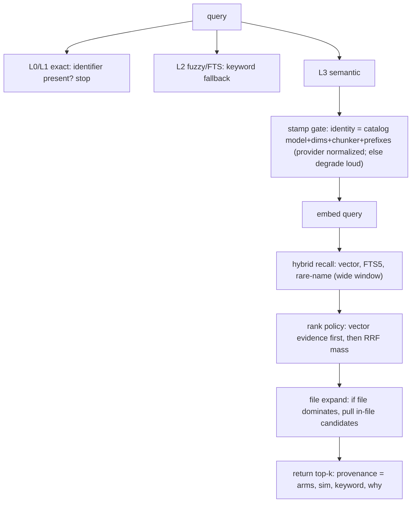

# LeanKG Multi-Repo Validation — Root Cause Deep Dive & Enhancement Plan

**Source:** `leankg-validation-report.html` (generated 2026-10-18)  
**Corpus:** 18 stores · 84,337 elements · 81,471 gemma-covered (96.6%) · 20 questions  
**Companion docs:** `docs/retrieval-miss-analysis.md`, `docs/retrieval-label-set.md`  
**Scope of this document:** root causes behind the measured miss pattern, code evidence, best-practice fixes, verification gates. No implementation in this pass.

> **Number check (2026-10-20).** The scoreboard (§1), the per-store coverage
> table (§2.1) and the RC4/RC5 symptom tables were re-checked against the
> validation report named above. The Oct-18 draft of §1 and §2.1 did not match
> that report and was corrected. Store names in the tables are anonymised in
> this public copy; the report maps them. Figures that the report does not
> publish (nDCG, the grep element-level row) are not stated here. These figures come from the 2026-10-18 validation report and predate #531, #532, #534 and #535 (3:1 vector fusion), and there is no re-run on disk, so none of them is a current measurement.

> **Status refreshed 2026-10-20.** The analysis below is the Oct-18 reading of
> the validation run and it still stands as the diagnosis; what changed since is
> how much of it has LANDED. **RC2's extractor fix shipped** (#531, the
> `function\b` word boundary, with #534 re-extracting on the version bump) and
> **RC3's stamp fix shipped** (#532 — the provider is a transport label, not
> part of the stamp identity — and #536, where a provider label alone no longer
> blocks a run or clears vectors). **RC1's measurement half shipped** in #533
> (the bench answers with grep baselines and its own denominators). The STORES
> still need the re-index and re-embed that the extractor fix implies (plan item
> 2) — that is an operations step, not a code one. **RC4, RC5 and RC6 are
> still open**: the 3:1 vector/keyword default (#535) mitigates RC4 but is not
> the rank policy it asks for, there is no within-file expansion (RC5), and the
> name arm's per-hit provenance is in the answer but has not been re-measured
> (RC6). The plan table in §6 carries the per-item status.

---

## 1. Executive summary

The validation run is **not** an embedding-quality failure. Gemma coverage is high (96.6% of elements have vectors). The scoreboard is dragged down by five independent defects that sit *around* the vectors: phantom index rows, stamp transport friction, hybrid fusion mixing evidence classes, missing within-file expansion, and a benchmark that under-counts true hits.

| Metric (validation report, 20 questions) | Semantic | Grep baseline |
|---|---|---|
| File-level Hit@5 | **100%** (20/20) | 40% (8/20) |
| File MRR | 0.730 | 0.262 |
| Element-level Hit@5, all 20 questions as published | **70%** (14/20) | not published |
| Element-level Hit@5, 15 exactly-qualified labels | **73.3%** (11/15) | not published |
| Element MRR, all 20 questions | 0.495 | not published |

**Read of the gap:** semantic is ahead of grep on *files* (100% vs 40% Hit@5). Element level is the weak spot: 70% over all 20 questions and 73.3% over the 15 exactly-qualified labels. The report publishes no grep element row, so an element-level comparison with grep is open. The element gap is mostly ranking/window composition and label/index hygiene — not “Gemma cannot embed code.”

**One-line diagnosis:** L3 is often answering with the wrong *kind* of evidence (FTS-only rows, phantoms, wrong symbol in the right file), or not answering at all (stamp degrade), while the bench sometimes asks for a name the graph never stored.

---

## 2. Scoreboard context (what the HTML actually measured)

### 2.1 Per-repo gemma coverage (from report)

| Store | Elements | Gemma vectors | Coverage | Missing | Phantoms |
|---|---:|---:|---:|---:|---:|
| S01 | 20,604 | 20,604 | 100.00% | 0 | 3 |
| S02 | 3,620 | 3,620 | 100.00% | 0 | 0 |
| S03 | 3,257 | 3,257 | 100.00% | 0 | 0 |
| S04 | 2,031 | 2,031 | 100.00% | 0 | 0 |
| S05 | 1,971 | 1,971 | 100.00% | 0 | 0 |
| S06 | 59 | 59 | 100.00% | 0 | 0 |
| S07 | 3,266 | 3,266 | 100.00% | 0 | 0 |
| S08 | 17,218 | 17,218 | 100.00% | 0 | 30 |
| S09 | 4,291 | 4,291 | 100.00% | 0 | 0 |
| S10 | 3,118 | 3,118 | 100.00% | 0 | 98 |
| S11 | 117 | 117 | 100.00% | 0 | 0 |
| S12 | 1,442 | 1,442 | 100.00% | 0 | 0 |
| S13 | 11,484 | 9,392 | **81.78% (2,092 short)** | 2,092 | 0 |
| S14 (not benchmarked) | 725 | 0 | 0.00% | 725 | 0 |
| leankg (not benchmarked) | 11,110 | 11,061 | 99.56% (49 short) | 49 | 1 |
| S16 (not benchmarked) | 24 | 24 | 100.00% | 0 | 0 |
| **Total (16 stores in totals)** | **84,337** | **81,471** | **96.6%** | 2,866 | 132 |

Two further stores (S17, S18) returned a query error (`no such column: chunker_version`) and are not in the totals. The per-store counts above are the report's rows; the Oct-18 draft of this table had different store rows and counts and is replaced.

**Coverage decay pattern:** a re-index that adds/replaces elements without a matching embed pass leaves new rows vector-less. `leankg index` is supposed to run incremental embed unless `--no-embed`; hook mode can *skip* embed when the pending set exceeds `LEANKG_HOOK_MAX_EMBED` (default 500). That is the operational root of S13’s 2,092 hole and leankg’s 49 hole — not model failure.

### 2.2 Miss shape (element-level)

From the HTML miss table and `docs/retrieval-miss-analysis.md`:

| Band | Meaning | Typical drivers |
|---|---|---|
| **Absent** | GT never in top window | phantoms, FTS crowding, no within-file expand, wrong/unqualified label |
| **Rank > 5** | GT in pool but not useful | RRF treating keyword-only equals vector; name arm silent |
| **Stamp degrade** | L3 never ran | provider string ≠ collection provider |
| **STALE label** | GT not in `code_elements` | extractor gap or label points at non-emitted symbol |

File-level Hit@5 = 100% while element Hit@5 = 70% (all 20 questions) is the strongest single signal: **we often know the file and still fail the symbol.** Q2, Q11 and Q16 are the report's clean examples (§3, RC5).

---

## 3. Root causes (RC1–RC6)

### RC1 — Benchmark labels under-qualified (measurement bug)

**Symptom:** Element metrics look worse than retrieval is. Unqualified bare names (`Open`, `lock`, `coverage`) match the wrong overload or mark a real near-hit as a miss.

**Evidence:**
- Label contract in `docs/retrieval-label-set.md`: ground truth is a full `qualified_name` checked against `code_elements`.
- Multi-repo HTML harness still carries bare / partially-qualified labels on 5 of the 20 cross-repo questions (Q3, Q6, Q7, Q9, Q19; report RC1 / fix plan item 3). Each omits the receiver, e.g. the store row is `Type.method`, the label is `method`.
- In-tree bench already knows STALE vs miss; multi-repo gather path did not always print the **valid-label denominator**.

**Root cause:** The scorer compares strings, not “same symbol.” Without receiver/type/package, Go methods and common names collide. Counting STALE labels as misses confuses indexer debt with ranker debt.

**Best practice:**
1. Every label is a store-resolved `qualified_name` (package + optional receiver + name), verified `COUNT(*) > 0` before the run.
2. Publish three denominators: `questions`, `valid_labels`, `l3_attempted` (exclude stamp-degraded from element fusion scores).
3. Score **file-level** and **element-level** as separate contracts (already in HTML — keep both; never roll up to one number).
4. On STALE: fail the *label*, not the system under test.

**Done when:** Element Hit@5 is reported as `hits/valid_l3_labels` with STALE and stamp-degraded listed separately; zero unqualified bare-name labels remain.

---

### RC2 — TS/JS extractor phantoms (`function` prefix absorption)

**Symptom:** Retrieval windows contain non-symbols, e.g. the tail `ality` captured from `functionality` (Q15). The report counts 132 phantoms across four stores (98 in S10, 30 in S08, 3 in S01, 1 in leankg). They occupy hybrid slots and dilute true neighbors.

**Code evidence:**

```48:48:internal/index/extract.go
tsFuncRe   = regexp.MustCompile(`^\s*(?:export\s+)?(?:default\s+)?(?:async\s+)?function\b\s*\*?\s*([A-Za-z_]\w*)`)
```

Before #531 (commit `226825c`), line 48 read `function\s*` with no `\b` (`git show 226825c^:internal/index/extract.go`).

**Root cause:** Older `function\s*` (no `\b`) let the keyword glue to the identifier when source was minified or ASI-joined. Phantoms were written as `code_elements`, then **embedded**, so they become first-class vector citizens.

**Status:** Regex fix **landed** in tree. Report still sees phantoms because **stores were not rebuilt** after the fix. Index replaces per-file elements, but only for files touched by a new index; stale DB rows + their vectors persist until re-index + re-embed of affected projects.

**Best practice:**
1. Keep `\b` (and prefer tree-sitter tier `-tags tstree` for TS/JS long-term — regex extractors will keep inventing edge-case phantoms).
2. Regression test: fixture source containing `functionality` must not emit an element named `ality` (only real `function name(` declarations may emit).
3. Operational: after extractor fixes, `leankg index <dir>` then embed to completion; assert `qualified_name NOT LIKE 'function%' OR qualified_name GLOB 'function'` style invariants in doctor/status.
4. Optional one-shot SQL purge of `function[a-zA-Z]%` phantoms is safe only when paired with re-index (do not delete real names that legitimately start with “function”).

**Done when:** `✘ zero phantom elements in any retrieval window` flips green on a regenerated HTML report.

---

### RC3 — Stamp identity treats transport alias as model drift

**Symptom:** Report RC3 — one query reason:

```text
stamp mismatch: collection differs from the live provider
(provider "local", live revision …); degraded from L3;
run `leankg-embed full` to rebuild
```

Gemma collection written with `provider=local`; bench queried through an OpenAI-compatible proxy alias. **Same model, same dims, different provider string → every similarity null → FTS-only answers.** A 100% embedded store becomes L3-dark for a config alias. The report shows this for 1 of 20 questions (Q20, the only degraded one).

**Code evidence:**

```1024:1025:internal/core/core.go
return degrade(fmt.Sprintf("stamp mismatch: collection differs from the live provider (%s); degraded from L3; run `leankg-embed full` to rebuild",
    stampDriftForLog(*stamp, want)))
```

`stampDriftForLog` (`internal/core/core.go:2110-2138`) used to compare `stored.Provider` against `want.Provider`. #532 removed that branch; provider is now only a comment at `core.go:2124`. `ModelStamp.Matches` (`internal/store/vectors.go:62-70`) compares model id, revision, dimensions, distance, chunker version and the prefix pair, and excludes provider.

The Oct-18 compare was strict on provider too. That was correct when provider implies **different embedding math**, and incorrect when provider is only a **client transport label** (`local` vs OpenAI-compatible wrapper in front of the same llama.cpp / gemma process).

**Root cause:** `ModelStamp.Provider` mixes two concepts:
- **Embedding identity** (what bytes produced the vector), and
- **Client routing** (how the process reached that model).

**Best practice (pick one; prefer A):**

| Option | Change | Pros | Cons |
|---|---|---|---|
| **A. Normalize at stamp write** | Map known local aliases → canonical `local` (or catalog id only) in `StampOf` | One collection; no query-time surprises | Must maintain alias list |
| **B. Compare without provider** | Match on `model_id + revision + dims + distance + chunker + prefixes` | Alias-proof | Hides true multi-provider collision if two backends share a name |
| **C. CompatibleWith()** | Explicit compatibility matrix (local ↔ openai-proxy for same base URL class) | Precise | More code |

Recommended: **A + catalog id as SoT**. Catalog already pins `model_id`/dims; provider should mean “embedding backend family,” not “HTTP client shape.” Bench must set `LEANKG_EMBED_MODEL` to the **catalog id**, not the `.gguf` filename (`docs/retrieval-label-set.md` already documents silent degrade when this is wrong).

**Done when:** every `-action semantic` query in the validation run returns `rung L3` (report checkbox).

---

### RC4 — Keyword-only rows consume the semantic window (`similarity = 0`)

**Symptom (HTML):**

| Q | Store | sim=0 slots | window |
|---|---|---:|---:|
| 7 | S13 | **4** | 10 |
| 14 | S03 | 3 | 10 |
| 17–18 | S01 | 2 | 10 |
| 1,5,6 | various | 1 | 10 |

Q7 gives **4/10** slots to rows the vector arm never placed, ahead of cosine-scored candidates.

**Code evidence** (`internal/store/hybrid_sqlite.go`, `HybridSearchScopedWeighted`):

- line 75: vector hit, `Similarity` set from the vector arm.
- line 96: FTS5-only hit, `HybridHit` created with `Similarity` left at zero.
- line 99: `KeywordScore` set from the FTS5 match.
- line 103: FTS5 keys appended as a rank list.

RRF (`FuseRRF` / weighted variant) merges **rank positions**, not scores. An FTS-only hit at rank 1 gets the same RRF mass as a vector rank-1 hit. After fusion, the shared top-N window is what the user sees as “semantic.” Provenance still says `rrf(vector+fts5)` even when half the window has `sim=0`.

**Root cause:** Evidence classes are fused into one list without a **presentation policy**. Hybrid search is the right *recall* tool; it is the wrong *default ranking* for a rung branded L3/semantic when keyword-only rows outrank vector rows.

**Best practice:**

1. **Two-phase ranking (minimal, recommended):**
   - Phase 1: RRF for candidate generation (keep as-is for recall).
   - Phase 2: stable sort key for the returned window:
     - primary: `has_vector_evidence` (sim > 0) before keyword-only;
     - secondary: RRF score / weighted RRF;
     - tertiary: cosine then bm25.
2. **Or** weighted RRF with vector weight > keyword on the semantic path. Both backends now share it: `FuseRRFWeighted` (`internal/store/pg_fts.go:194`), the 3:1 `DefaultFuseWeights` (`pg_fts.go:118-120`, #535), and the SQLite `HybridSearchScopedWeighted` (`internal/store/hybrid_sqlite.go:60`).
3. **Or** split API: `hybrid` vs `semantic_strict` (vector-only window) — only if agents need both; don’t add a third rung without a caller.
4. Never drop keyword-only entirely: they save exact-identifier paraphrases; they must not **occupy** semantic top-k ahead of scored neighbors.

**Done when:** on the validation set, `sim=0` rows in the top-10 semantic window are 0 when ≥k vector hits exist; element MRR rises without file MRR falling.

---

### RC5 — Element dilution when file-level is strong

**Symptom (HTML):**

| Q | Store | file rank | element rank | GT-file entries in window |
|---|---|---:|---|---:|
| 11 | S06 | **1** | absent | 6 |
| 16 | S08 | **1** | absent | 2 |
| 2 | S11 | 5 | absent | 2 |

Retrieval finds the right file (twice at rank 1) while the answering element never appears. Multiple other symbols from that file pad the window.

**Root cause:** Arms retrieve **elements**, not files. High file recall is an emergent property of many element hits sharing a path. There is no second stage: “given file F dominates, promote elements *in F* that best match the query.”

**Best practice:**

1. **Within-file expansion (cheap, high leverage):**
   - After hybrid top-N, if file F accounts for ≥t hits or best hit’s file is unique leader, pull additional elements from F (by residual cosine to qvec, or by name/FTS within file) and re-rank.
2. **File-first agent pattern (no code):** for impact/edit tasks, use semantic to get file, then L1/L2 or structured outline inside the file — document in agent guidance even before code lands.
3. **Chunk granularity:** ensure methods/types are separate elements (extractor completeness) so the right symbol *exists* to be promoted.
4. Cap per-file diversity in the first window (mmr-style) so one noisy file cannot fill 6 slots with the wrong symbols — then expand intentionally.

**Done when:** cases with file rank ≤3 and GT present in store show element rank ≤5 after expansion; Q11/Q16-class misses disappear.

---

### RC6 — Name arm rarity gate silences the arm on natural-language questions

**Symptom:** Reasons include `rrf(vector+fts5+name)` on 9/20 questions, yet the arm does not move the needle when the query has **no literal symbol token** (the report: none of those 9 contains the target symbol's name). Conversely, when the query *is* a rare identifier paraphrase, the gate may still drop tokens that are common in a large monorepo graph.

**Code evidence:**

```107:108:internal/store/hybrid_sqlite.go
// The name arm: symbol-name evidence fused in, gated on RARITY in this
// corpus rather than on the query's shape.
```

```339:342:internal/store/elements.go
bound := total / 5000
if bound < 2 {
    bound = 2
}
```

`nameArmBound` (`elements.go:338-339`) is the live divisor, elements/5000 with floor 2. `rareNameTokens` is at `elements.go:361`. Its doc comment (`elements.go:356`) still says elements/500; that comment is stale against the code and is reported here, not changed.

**Root cause:** Name arm is designed for **rare symbol tokens in the query string**, not for semantic paraphrases. Natural-language bench questions (“the Store constructor that opens sqlite”) contain English words, not `Open`. Seeing `+name` in provenance only means rare tokens were *attempted*; it does not mean a useful name hit entered RRF. Treating RC6 as “raise the bound” without provenance will thrash precision on large graphs (the sweep at `elements.go:315-335` and the comment at `elements.go:356-359` were measured on leankg's own 10,885-element store, not on the 18-store corpus; they cite token `lock` with 95 hits).

**Best practice:**
1. **Instrument first:** per query, log `name_tokens_kept`, `name_hits`, `name_hits_in_fused_top10`. Re-measure before touching the bound.
2. Keep rarity gate; add **exact identifier path** already served by L1 — do not force name-arm to replace L1.
3. Optional: light stem/camel split (`IncrementalVacuum` → `incremental`, `vacuum`) with stricter rarity on fragments.
4. Do not expect name-arm to fix paraphrase questions — that is vector’s job (RC4/RC5).

**Done when:** instrumentation shows when `+name` changes ranks; bound changes are backed by before/after on `docs/retrieval-label-set.md`, not intuition.

---

## 4. Cross-cutting operational causes

### 4.1 Index without completed embed → coverage decay

- **S13 81.78%** (2,092 missing vectors), **leankg 99.56%** (49 short) after reindex-without-reembed style operations.
- Hook path: `leankg index --hook` may skip embed over `LEANKG_HOOK_MAX_EMBED`.
- Best practice: treat **coverage %** and **stamp match** as first-class SLOs in `leankg status` / doctor; CI or dogfood gate `coverage >= 99.5%` on dogfood repos; never run validation when stamp degraded or coverage below threshold.

### 4.2 Regex extractor ceiling

- Phantoms (RC2) are one instance. Unexported helpers / interface methods not emitted → STALE labels (label set § “Only extractable symbols”).
- Best practice: labels only on extractable symbols; expand extractor or tstree tier for languages that dominate misses; never mark extractor gaps as fusion failures.

### 4.3 Grep is not the enemy

- Grep file Hit@5 is 40% against semantic 100% in this run, so the file-level comparison favours semantic. The grep column stays as the baseline the report publishes side by side.
- Publish **side-by-side forever** (report already does). Optimization target: close element gap without regressing file; beat grep on paraphrase subset, not on exact-string subset. The report has no grep element row, so that comparison has to be added before a gain can be claimed.

---

## 5. Best-practice target architecture (retrieval)



Principles:
1. **Don’t mix measurement bugs with ranker bugs** (RC1).
2. **Don’t embed garbage** (RC2).
3. **Don’t false-degrade L3** (RC3).
4. **Semantic window must be semantically ordered** (RC4).
5. **File confidence should promote elements** (RC5).
6. **Name arm is a scalpel** (RC6) — instrument before retuning.

---

## 6. Enhancement plan (priority order)

| Pri | Item | Where | Effort | Depends on | Status (as of HTML) |
|---:|---|---|---|---|---|
| 1 | TS/JS `function\b` + test | `internal/index/extract.go` | S | — | **landed** (#531; #534 bumps the extractor version so the fix re-extracts) |
| 2 | Re-index + re-embed stores with phantoms / coverage holes | ops pipeline | M | 1 | pending |
| 3 | Qualify labels; resolve; print denominators | bench / `gather_validation.py` | S | — | **partial** — the in-tree bench answers with grep baselines and its own denominators (#533); the multi-repo gather path's label resolution is still open |
| 4 | Provider alias normalization / stamp compare fix | `internal/embed`, `internal/core` | S | — | **landed** — #532 (the provider is a transport label, not part of the stamp identity) and #536 (a provider label alone no longer blocks a run or clears vectors) |
| 5 | Rank policy: no sim=0 above scored rows | `internal/store` hybrid fuse path | M | — | pending |
| 6 | Within-file expansion | `internal/store` or `internal/core` | M | 5 | pending |
| 7 | Name-arm provenance + remeasure | `internal/store/elements.go` | S→M | bench | **partial** — the per-hit arm ranks ship in the answer (`ranks`), so the provenance is there; the re-measure has not been run |
| 8 | Coverage SLO in status/doctor + hook embed policy | cmd/status, index hook | S | 2 | pending |
| 9 | tstree tier for TS/JS as extractor SoT | `internal/tstree` | L | 1–2 | later |

### Suggested implementation slices (when you implement)

1. **Slice A — Make the scoreboard honest:** RC1 + RC3 config in bench + coverage preflight. No ranker changes. Re-run HTML.
2. **Slice B — Clean the graph:** RC2 purge via reindex/embed; doctor phantom check.
3. **Slice C — Ranker:** RC4 sort policy (+ weights if already wired on PG).
4. **Slice D — File expand:** RC5.
5. **Slice E — Name arm data-driven tune:** RC6.

Do not start C–E until A shows stable denominators; otherwise diffs are noise.

---

## 7. Verification gates (“done” checklist)

From the HTML report, expanded with measurable thresholds:

| Gate | Target |
|---|---|
| Phantoms in any top-10 window | **0** |
| Semantic queries at L3 (not stamp-degraded) | **100%** of run |
| Element metrics denominator | **valid labels only**, printed |
| Gemma coverage on dogfood stores | **≥ 99.5%** (or documented hole) |
| `sim=0` rows above vector rows when vector pool ≥ k | **0** |
| File Hit@5 | **≥ 100%** is the Oct-18 reading (pre-#535, not re-measured); re-run and then hold, do not treat 100% as current |
| Element Hit@5 on valid labels | **≥ 55%** first milestone and **≥ 65%** stretch; the Oct-18 run already reads 73.3% on 15 valid labels, so the open gate is the grep element row (not published), needed for "match grep" |
| File / element / grep columns | always published side by side |
| Report | **regenerated**, not hand-edited |

Runnable checks (minimal):
- Unit: TS phantom non-extraction; hybrid sort puts `sim>0` before `sim==0`; stamp aliases compare equal.
- Integration (env-gated): `scripts/retrieval-bench.py` on labelled set; multi-repo HTML gather.
- Ops: `leankg status` coverage + stamp; `lsof` single-server discipline when dogfooding serve.

---

## 8. What not to do

- Do **not** “fix embed everything” hoping Hit@5 jumps — coverage is already 96.6% global.
- Do **not** remove FTS from hybrid — keyword-only is a recall feature; fix ordering, not existence.
- Do **not** loosen stamp to ignore dims/prefixes/chunker — only de-risk **provider transport** aliases.
- Do **not** raise name-arm rarity bound without per-query instrumentation.
- Do **not** bulk-index the freepeak portfolio root (project rule); validate per project store.
- Do **not** treat grep losses on exact identifiers as semantic regressions.

---

## 9. Traceability map (report → code → fix)

| HTML RC | Primary code | Fix class |
|---|---|---|
| RC1 labels | bench / label JSON / `docs/retrieval-label-set.md` | measurement |
| RC2 phantoms | `internal/index/extract.go` `tsFuncRe` | index + reembed |
| RC3 stamp | `internal/core` stamp drift + `internal/embed` `StampOf` | identity normalize |
| RC4 sim=0 | `internal/store/hybrid_sqlite.go` + `FuseRRF*` | rank policy |
| RC5 dilution | hybrid result post-process / core L3 | file expand |
| RC6 name | `internal/store/elements.go` `rareNameTokens` | instrument then tune |
| Coverage | index hook + embed pipeline | ops SLO |

---

## 10. Bottom line

Gemma vectors on this corpus are **good enough to find the right file 100% Hit@5 (20/20)**. The system loses element-level quality because:

1. it sometimes **does not run L3** (stamp alias),  
2. it **pollutes** the graph and the window (phantoms, sim=0 crowding),  
3. it **stops at file-ish evidence** without promoting the right symbol, and  
4. the **bench under-qualifies** what “right” means.

Fix measurement and stamp first, rebuild dirty stores, then rank policy + file expansion. That sequence is the shortest path to a green regeneration of `leankg-validation-report.html`.

---

*Generated from `leankg-validation-report.html` (2026-10-18) and in-tree sources under `leankg/`. This document is analysis only; no code changes included.*
